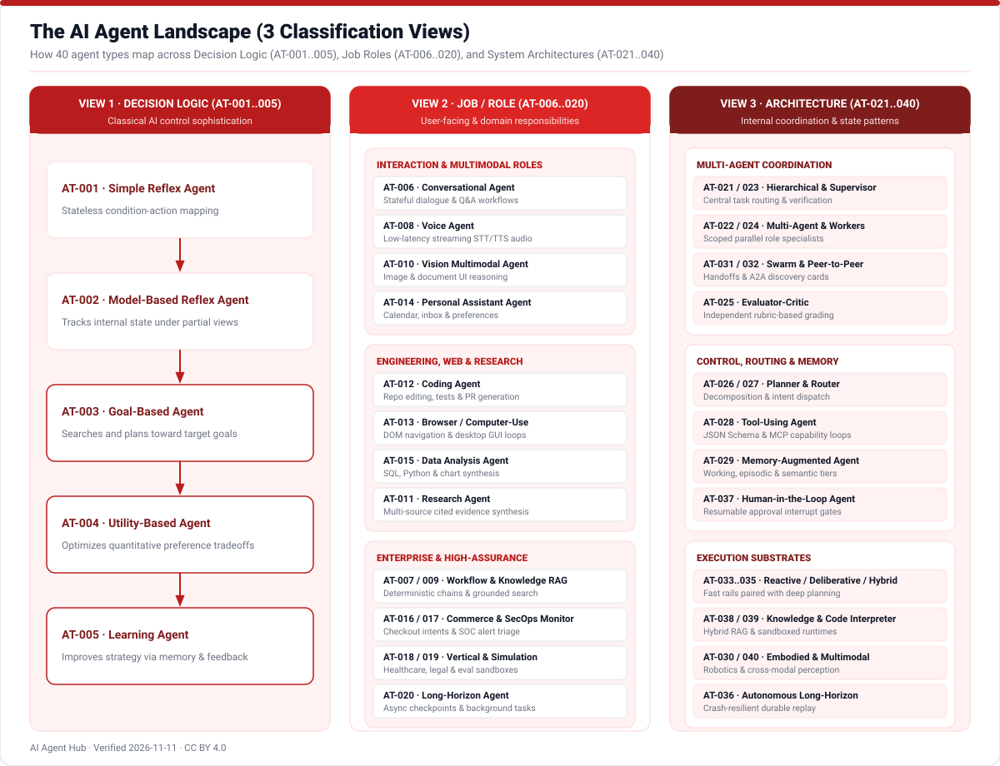
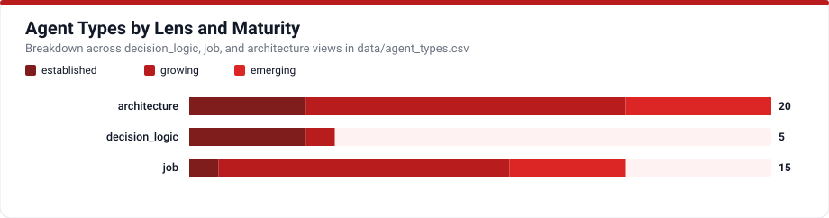
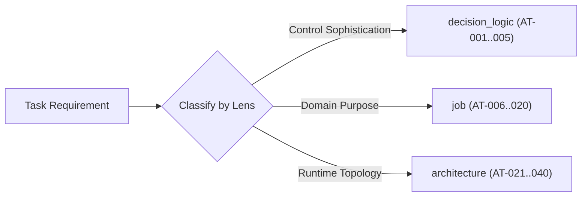

# AI Agent Types Taxonomy

AI Agent Hub classifies **40 distinct agent archetypes** across three complementary lenses so engineers, architects, and product leaders can communicate precisely without conflating classic control theory with deployment roles or software topologies.

## Understanding the Three Classification Views

1. **`decision_logic` (`AT-001` through `AT-005`)**: Classical rational-agent control ladder spanning stateless condition-action rules through model-based state tracking, forward planning, preference utility optimization, and feedback learning.
2. **`job` (`AT-006` through `AT-020`)**: User-facing and operational responsibilities such as coding agents, browser operators, voice assistants, SecOps monitors, commerce agents, and long-horizon workers.
3. **`architecture` (`AT-021` through `AT-040`)**: Internal system structure covering supervisors, hierarchical teams, decentralized swarms, memory-augmented agents, and code-interpreting runtimes.

## Complete Agent Types Catalog

<!-- TABLE_AGENT_TYPES:START -->
| ID | Type | Lens | Maturity | Difficulty | Confidence | Status |
|---|---|---|---|---|---|---|
| [AT-001](types/AT-001.md) | `simple_reflex_agent` | decision_logic | established | beginner | high | active |
| [AT-002](types/AT-002.md) | `model_based_reflex_agent` | decision_logic | established | intermediate | high | active |
| [AT-003](types/AT-003.md) | `goal_based_agent` | decision_logic | established | intermediate | high | active |
| [AT-004](types/AT-004.md) | `utility_based_agent` | decision_logic | established | advanced | high | active |
| [AT-005](types/AT-005.md) | `learning_agent` | decision_logic | growing | advanced | high | active |
| [AT-006](types/AT-006.md) | `conversational_agent` | job | established | beginner | high | active |
| [AT-007](types/AT-007.md) | `workflow_agent` | job | growing | intermediate | high | active |
| [AT-008](types/AT-008.md) | `voice_agent` | job | growing | intermediate | high | active |
| [AT-009](types/AT-009.md) | `knowledge_rag_agent` | job | growing | intermediate | high | active |
| [AT-010](types/AT-010.md) | `vision_multimodal_agent` | job | growing | advanced | high | active |
| [AT-011](types/AT-011.md) | `research_agent` | job | growing | intermediate | high | active |
| [AT-012](types/AT-012.md) | `coding_agent` | job | growing | advanced | high | active |
| [AT-013](types/AT-013.md) | `browser_computer_use_agent` | job | emerging | advanced | high | active |
| [AT-014](types/AT-014.md) | `personal_assistant_agent` | job | growing | intermediate | medium | needs-review |
| [AT-015](types/AT-015.md) | `data_analysis_agent` | job | growing | intermediate | high | active |
| [AT-016](types/AT-016.md) | `commerce_transaction_agent` | job | emerging | advanced | medium | needs-review |
| [AT-017](types/AT-017.md) | `security_monitoring_agent` | job | emerging | advanced | high | active |
| [AT-018](types/AT-018.md) | `vertical_industry_agent` | job | growing | advanced | medium | needs-review |
| [AT-019](types/AT-019.md) | `simulation_game_agent` | job | growing | advanced | high | active |
| [AT-020](types/AT-020.md) | `long_horizon_agent` | job | emerging | advanced | medium | needs-review |
| [AT-021](types/AT-021.md) | `hierarchical_agent` | architecture | growing | advanced | high | active |
| [AT-022](types/AT-022.md) | `multi_agent_system` | architecture | growing | advanced | high | active |
| [AT-023](types/AT-023.md) | `supervisor_orchestrator` | architecture | growing | advanced | high | active |
| [AT-024](types/AT-024.md) | `worker_specialist` | architecture | growing | intermediate | high | active |
| [AT-025](types/AT-025.md) | `evaluator_critic` | architecture | growing | advanced | high | active |
| [AT-026](types/AT-026.md) | `planner_agent` | architecture | growing | advanced | high | active |
| [AT-027](types/AT-027.md) | `router_agent` | architecture | growing | intermediate | high | active |
| [AT-028](types/AT-028.md) | `tool_using_agent` | architecture | established | intermediate | high | active |
| [AT-029](types/AT-029.md) | `memory_augmented_agent` | architecture | growing | advanced | high | active |
| [AT-030](types/AT-030.md) | `embodied_robotic_agent` | architecture | emerging | advanced | high | active |
| [AT-031](types/AT-031.md) | `swarm_agent` | architecture | emerging | advanced | medium | needs-review |
| [AT-032](types/AT-032.md) | `peer_to_peer_agent` | architecture | emerging | advanced | medium | needs-review |
| [AT-033](types/AT-033.md) | `reactive_agent` | architecture | established | beginner | high | active |
| [AT-034](types/AT-034.md) | `deliberative_agent` | architecture | established | advanced | high | active |
| [AT-035](types/AT-035.md) | `hybrid_agent` | architecture | growing | advanced | medium | needs-review |
| [AT-036](types/AT-036.md) | `autonomous_long_horizon_agent` | architecture | emerging | advanced | medium | needs-review |
| [AT-037](types/AT-037.md) | `human_in_loop_agent` | architecture | growing | intermediate | high | active |
| [AT-038](types/AT-038.md) | `knowledge_base_agent` | architecture | established | intermediate | high | active |
| [AT-039](types/AT-039.md) | `code_interpreter_agent` | architecture | growing | advanced | high | active |
| [AT-040](types/AT-040.md) | `multimodal_reasoning_agent` | architecture | emerging | advanced | high | active |
<!-- TABLE_AGENT_TYPES:END -->

Every ID above links to its complete per-type specification page under [`docs/types/`](types/AT-001.md) containing strengths, limitations, examples, relationship edges, and verified primary citations.
