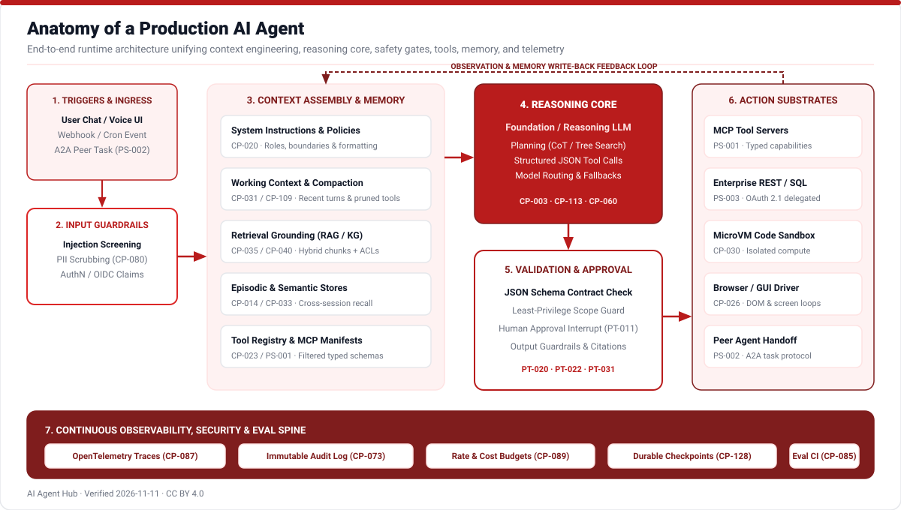
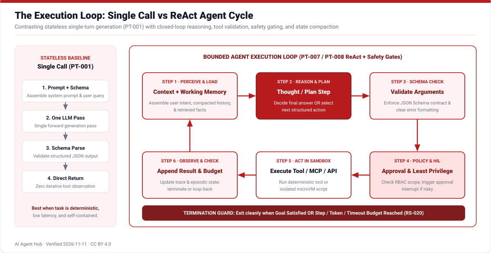
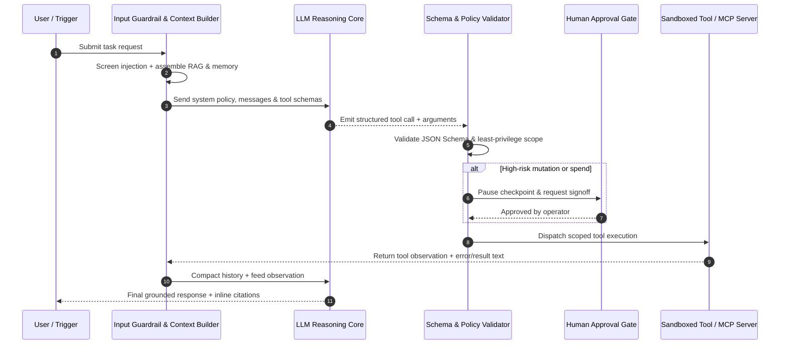
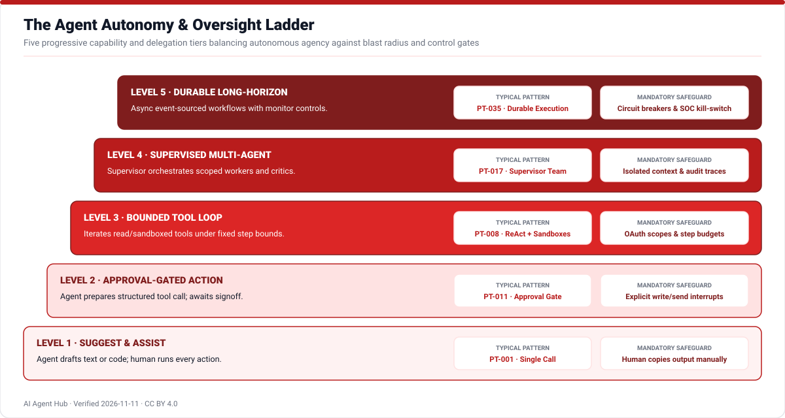
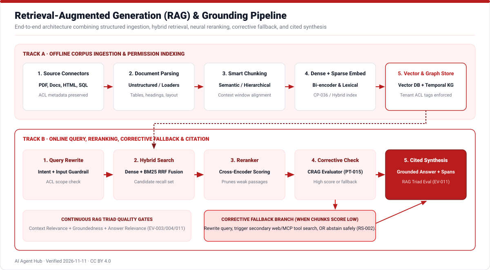

# Architecture of an AI Agent

A production AI agent combines a foundation reasoning model with curated working context, validated action schemas, persistent memory, security guardrails, and telemetry observability. Rather than treating intelligence solely as a monolithic prompt, modern architectures decompose execution into deterministic software loops surrounding bounded stochastic reasoning steps.

## 1. The Iterative Agent Loop

Stateless single-turn calls ([`PT-001`](patterns.md)) execute one prompt and stop. By contrast, a ReAct or tool-calling agent ([`CP-060`](concepts/CP-060.md), [`CP-022`](concepts/CP-022.md)) alternates model reasoning with external tool execution until an explicit stop criterion or budget guard terminates the run.

### Tool Execution Sequence

## 2. Autonomy Levels & Human Control

Designers explicitly bound how much operational latitude an agent holds based on failure blast radius ([`CP-102`](concepts/CP-102.md)). High-impact mutations require resumable human-in-the-loop interrupts ([`CP-078`](concepts/CP-078.md)), while read-only exploration and verifiable test suites can iterate autonomously inside isolated microVM sandboxes ([`CP-030`](concepts/CP-030.md)).

## 3. Retrieval & Grounding Pipeline

To connect models with fresh, access-controlled institutional knowledge without retraining model weights, agents pair offline ETL ingestion with online hybrid dense/keyword search, cross-encoder reranking, corrective quality evaluation, and cryptographic inline citations ([`CP-035`](concepts/CP-035.md), [`CP-040`](concepts/CP-040.md), [`CP-039`](concepts/CP-039.md), [`CP-136`](concepts/CP-136.md)).

---

**Next Steps:** Explore the 40 concrete classifications in [Agent Types](agent-types.md), inspect the 35 reusable designs in [Design Patterns](patterns.md), or examine [Open Protocols](protocols.md).
