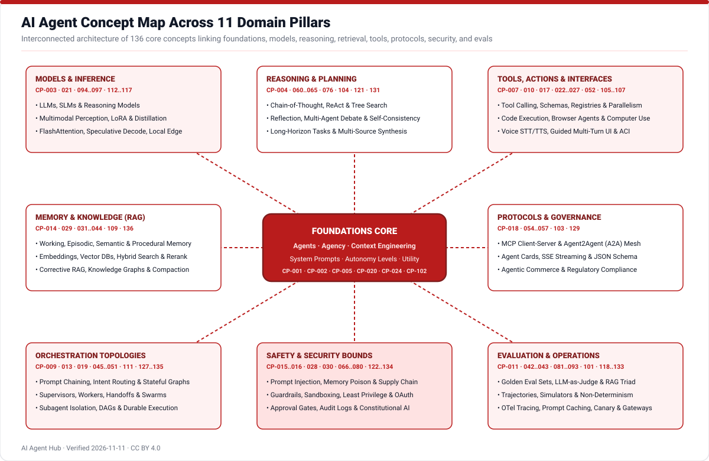
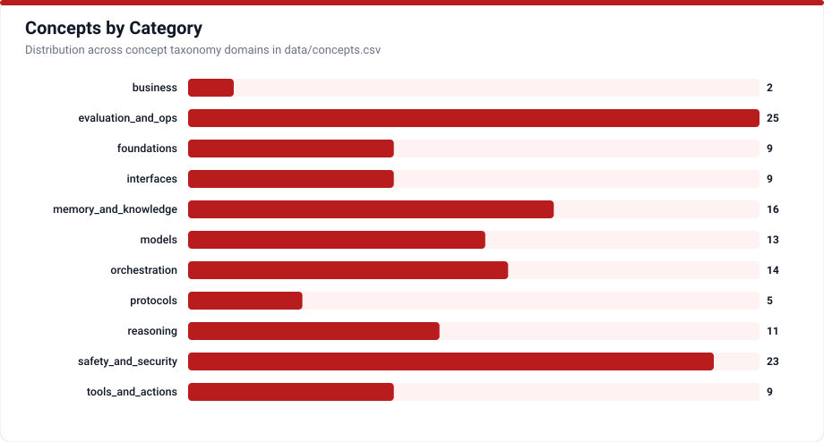

# Core Concepts Glossary & Dependency Graph

AI Agent Hub documents **136 core concepts** organized into 11 cohesive engineering domains (`CP-001` through `CP-136`). Every concept enforces a strict acyclic prerequisite chain, connects explicitly into `relationships.csv`, and anchors every claim to verified primary documentation or peer-reviewed papers.

## Domain Pillars (11 Categories)

| Domain Icon | Category | Focus Area |
|---|---|---|
|  | `foundations` | Rational agency, prompts, context engineering, autonomy tiers |
|  | `models` | Foundation LLMs, small language models, reasoning models, LoRA, distillation, FlashAttention |
|  | `reasoning` | CoT, ReAct, tree search, episodic reflection, multi-agent debate |
|  | `tools_and_actions` | Function calling, JSON contracts, registries, parallel execution, code execution |
|  | `memory_and_knowledge` | Short-term, episodic, semantic, procedural memory, hybrid RAG, reranking, compaction |
|  | `orchestration` | Stateful graphs, intent routing, supervisors, handoffs, swarms, subagents, durable execution |
|  | `protocols` | MCP, A2A, Agent Cards, streaming SSE, JSON Schema |
|  | `safety_and_security` | Prompt injection, guardrails, sandboxes, OAuth delegation, least privilege, audit logs |
|  | `evaluation_and_ops` | Golden evals, pass^k variance, LLM-as-judge, RAG Triad, OTel tracing, canary rollouts |
|  | `interfaces` | Voice/audio agents, STT/TTS, browser automation, computer use, ACI |
|  | `business` | Delegated agentic commerce, regulatory & governance compliance |

## Complete Concept Index (`CP-001` to `CP-136`)

<!-- TABLE_CONCEPTS:START -->
| ID | Term | Category | Difficulty | Definition | Confidence |
|---|---|---|---|---|---|
| [CP-001](concepts/CP-001.md) | agent | foundations | beginner | An autonomous or semi-autonomous entity that perceives its environment via sensors or inputs, reasons over state, and executes actions via actuators or tools toward goals. | high |
| [CP-002](concepts/CP-002.md) | agentic AI | foundations | beginner | AI systems in which foundation models dynamically direct their own execution flow, intermediate reasoning, memory lookups, and tool invocations across multiple steps. | high |
| [CP-003](concepts/CP-003.md) | LLM | models | beginner | A large language model built on Transformer neural architectures trained on vast text and code corpora to predict tokens and follow instructions. | high |
| [CP-004](concepts/CP-004.md) | planning | reasoning | intermediate | The capability of an agent to decompose a high-level objective into ordered sub-goals, dependencies, and contingency steps before or during execution. | high |
| [CP-005](concepts/CP-005.md) | utility and reward optimization | foundations | intermediate | Decision modeling that assigns scalar preferences over competing world states so an agent selects actions maximizing expected utility under constraints. | high |
| [CP-006](concepts/CP-006.md) | adaptive learning in agents | reasoning | advanced | Mechanisms by which an agent improves future behavior from execution feedback, critic evaluations, or parameter updates over repeated episodes. | high |
| [CP-007](concepts/CP-007.md) | conversation state and turns | interfaces | beginner | Structured management of alternating user, assistant, system, and tool messages across a multi-turn session. | high |
| [CP-008](concepts/CP-008.md) | prompt | foundations | beginner | The structured natural-language, multimodal, and schema payload supplied to a model at inference time to elicit a desired response or action. | high |
| [CP-009](concepts/CP-009.md) | stateful workflow execution | orchestration | intermediate | Coordinating multi-step agent logic through explicit graph nodes, transitions, checkpoints, and conditional control flow. | high |
| [CP-010](concepts/CP-010.md) | voice and audio interaction | interfaces | intermediate | Real-time conversational interfaces combining audio capture, speech understanding, low-latency turn detection, and synthesized spoken output. | high |
| [CP-011](concepts/CP-011.md) | programmatic prompt optimization | evaluation_and_ops | advanced | Algorithmic compilation of prompts, instructions, and few-shot examples against an objective evaluation metric rather than manual trial and error. | high |
| [CP-012](concepts/CP-012.md) | visual understanding and perception | models | intermediate | The ability of multimodal models and agents to interpret screenshots, charts, scanned documents, diagrams, and camera frames alongside text. | high |
| [CP-013](concepts/CP-013.md) | intent classification and routing | orchestration | beginner | Inspecting an incoming request or intermediate signal and directing it to the most suitable specialist prompt, workflow branch, tool, or model. | high |
| [CP-014](concepts/CP-014.md) | episodic memory | memory_and_knowledge | intermediate | Long-term storage and retrieval of past interaction episodes, experiences, actions taken, and outcomes tied to specific contexts or sessions. | high |
| [CP-015](concepts/CP-015.md) | policy constraints and action bounds | safety_and_security | intermediate | Explicit machine-enforced rules specifying spending caps, allowable domains, rate quotas, and restricted operations an agent cannot cross. | high |
| [CP-016](concepts/CP-016.md) | human-in-the-loop | safety_and_security | beginner | System design integrating human judgment, oversight, escalation, or explicit confirmation into critical stages of an agent workflow. | high |
| [CP-017](concepts/CP-017.md) | structured output | tools_and_actions | beginner | Constraining model generation so responses conform deterministically to typed JSON schemas or typed object models. | high |
| [CP-018](concepts/CP-018.md) | JSON Schema | protocols | beginner | A declarative vocabulary standard for describing the structure, required fields, types, enums, and regex constraints of JSON data. | high |
| [CP-019](concepts/CP-019.md) | prompt chaining | orchestration | beginner | Decomposing a complex task into sequential model steps where each step consumes and transforms the validated output of the prior stage. | high |
| [CP-020](concepts/CP-020.md) | system prompt | foundations | beginner | Top-level developer instructions separated in model APIs from user turns to define an agent's identity, boundaries, tool rules, and tone. | high |
| [CP-021](concepts/CP-021.md) | context window | models | beginner | The maximum sequence length measured in tokens that a language model can attend to in a single forward pass, covering inputs and outputs. | high |
| [CP-022](concepts/CP-022.md) | tool calling | tools_and_actions | beginner | The capability of an LLM to generate structured tool invocation requests matching registered schemas so host software can execute external actions. | high |
| [CP-023](concepts/CP-023.md) | tool registry | tools_and_actions | intermediate | A central catalog managing available tool definitions, versioned schemas, metadata, authentication bindings, and access policies for agents. | high |
| [CP-024](concepts/CP-024.md) | context engineering | foundations | intermediate | The systematic practice of curating, structuring, compressing, and pruning all tokens entering a model's context across multi-turn agent loops. | high |
| [CP-025](concepts/CP-025.md) | code execution by agents | tools_and_actions | intermediate | Granting an agent the ability to author, run, inspect, and iteratively debug programmatic code to solve computation or repository tasks. | high |
| [CP-026](concepts/CP-026.md) | browser automation | interfaces | intermediate | Programmatic control of web browsers by agents to navigate pages, inspect DOM accessibility trees, fill forms, and extract dynamic web content. | high |
| [CP-027](concepts/CP-027.md) | computer use | interfaces | advanced | End-to-end GUI and desktop control where a multimodal agent perceives screen pixels and dispatches mouse, keyboard, and shell actions across arbitrary software. | high |
| [CP-028](concepts/CP-028.md) | delegated tool authentication | safety_and_security | intermediate | Securely obtaining and scoping user-authorized credentials and OAuth tokens on behalf of an agent acting against external third-party APIs. | high |
| [CP-029](concepts/CP-029.md) | memory write-back | memory_and_knowledge | intermediate | Selecting, distilling, resolving conflicts in, and persisting new facts or experiences from active sessions into durable agent memory stores. | high |
| [CP-030](concepts/CP-030.md) | sandboxing | safety_and_security | intermediate | Executing untrusted model-generated code, shell utilities, or browsers inside isolated compute boundaries with restricted filesystem, process, and egress access. | high |
| [CP-031](concepts/CP-031.md) | short-term memory | memory_and_knowledge | beginner | Working context retained within a single task run or session thread, including recent messages, scratchpads, and active tool states. | high |
| [CP-032](concepts/CP-032.md) | long-term memory | memory_and_knowledge | intermediate | Persistent agent knowledge and experience stored externally across separate sessions and selectively recalled when relevant to future tasks. | high |
| [CP-033](concepts/CP-033.md) | semantic memory | memory_and_knowledge | intermediate | Durable storage of general domain facts, entity profiles, relationships, and world knowledge independent of single timestamped conversations. | high |
| [CP-034](concepts/CP-034.md) | procedural memory | memory_and_knowledge | intermediate | Stored rules, skills, system instructions, prompt templates, and learned workflows encoding how an agent performs recurring procedures. | high |
| [CP-035](concepts/CP-035.md) | RAG | memory_and_knowledge | beginner | Retrieval-Augmented Generation combines parametric language models with external non-parametric document retrieval at inference time to ground responses. | high |
| [CP-036](concepts/CP-036.md) | embeddings | memory_and_knowledge | beginner | Dense numerical vectors generated by encoder models to capture semantic similarity between text, code, or multimodal items in vector space. | high |
| [CP-037](concepts/CP-037.md) | vector store | memory_and_knowledge | beginner | Specialized storage and approximate nearest-neighbor indexing engines optimized for similarity search and metadata filtering over high-dimensional vectors. | high |
| [CP-038](concepts/CP-038.md) | chunking | memory_and_knowledge | beginner | Splitting source documents into coherent, sized passages with structural boundaries and metadata before indexing for retrieval. | high |
| [CP-039](concepts/CP-039.md) | reranking | memory_and_knowledge | intermediate | A second-stage relevance scoring step using cross-encoders or specialized rankers to reorder initial retrieval candidates accurately. | high |
| [CP-040](concepts/CP-040.md) | hybrid search | memory_and_knowledge | intermediate | Combining lexical keyword search such as BM25 with dense vector similarity search via score fusion or reciprocal rank fusion. | high |
| [CP-041](concepts/CP-041.md) | knowledge graph | memory_and_knowledge | intermediate | A graph-structured store representing typed entities and explicit multi-hop relationships for structured traversal alongside text search. | high |
| [CP-042](concepts/CP-042.md) | citation | evaluation_and_ops | beginner | Attaching verifiable references linking generated agent statements back to exact retrieved source documents, spans, or tool outputs. | high |
| [CP-043](concepts/CP-043.md) | grounding | evaluation_and_ops | beginner | Anchoring model outputs strictly in verified retrieved evidence, live tool state, or sensor observations rather than parametric memory alone. | high |
| [CP-044](concepts/CP-044.md) | document parsing and ingestion | memory_and_knowledge | beginner | Extracting clean structured text, tables, headings, and metadata from heterogeneous PDF, Word, HTML, and slide formats for indexing. | high |
| [CP-045](concepts/CP-045.md) | orchestration | orchestration | intermediate | Coordinating execution order, branching, state passing, concurrency, error recovery, and tool invocation across an agentic application. | high |
| [CP-046](concepts/CP-046.md) | multi-agent system | orchestration | intermediate | An architecture where multiple specialized agents collaborate, compete, or delegate sub-tasks across distinct prompts, tools, or context windows. | high |
| [CP-047](concepts/CP-047.md) | orchestrator and workers | orchestration | intermediate | A hierarchical pattern in which a central orchestrator decomposes complex requests, dispatches parallel or sequential worker agents, and synthesizes results. | high |
| [CP-048](concepts/CP-048.md) | supervisor | orchestration | intermediate | A controlling coordinator agent that monitors worker agents, assigns turns, checks intermediate compliance, and decides routing or termination. | high |
| [CP-049](concepts/CP-049.md) | handoff | orchestration | intermediate | Explicit transfer of execution control, user session state, and responsibility from one agent or human operator to another. | high |
| [CP-050](concepts/CP-050.md) | agent state management | orchestration | intermediate | Explicit schema-typed tracking, persistence, and checkpointing of variables, messages, artifacts, and execution cursors across steps. | high |
| [CP-051](concepts/CP-051.md) | swarm coordination | orchestration | advanced | Decentralized multi-agent collaboration where peers pass tasks, share signals on a board, or negotiate locally without strict central control. | high |
| [CP-052](concepts/CP-052.md) | document information extraction | tools_and_actions | beginner | Using language and vision models with strict schemas to extract structured fields, dates, tables, and obligations from unstructured business documents. | high |
| [CP-053](concepts/CP-053.md) | guided multi-turn workflow | interfaces | beginner | Combining natural-language dialogue with structured step progression, validation checks, and dynamic slot filling to complete multi-step forms or intakes. | high |
| [CP-054](concepts/CP-054.md) | MCP | protocols | intermediate | Model Context Protocol is an open specification standardizing how AI host applications connect securely to external context, prompts, and tools. | high |
| [CP-055](concepts/CP-055.md) | A2A | protocols | intermediate | Agent2Agent is an open protocol enabling opaque, independent AI agents across vendors and runtimes to discover capabilities and collaborate on tasks. | high |
| [CP-056](concepts/CP-056.md) | agent card | protocols | intermediate | A standardized JSON metadata document published by an A2A-compliant agent advertising its identity, endpoint, capabilities, skills, and auth requirements. | high |
| [CP-057](concepts/CP-057.md) | streaming events and SSE | protocols | intermediate | Delivering incremental token chunks, tool status updates, and task progress events continuously from servers to clients over HTTP or WebSockets. | high |
| [CP-058](concepts/CP-058.md) | tool schema contract | tools_and_actions | beginner | Formal specification of a tool's name, purpose, parameter JSON Schema, expected side-effect flags, and return payload structure. | high |
| [CP-059](concepts/CP-059.md) | parallel tool execution | tools_and_actions | intermediate | Issuing and running multiple independent tool calls simultaneously within a single agent turn to reduce wall-clock execution time. | high |
| [CP-060](concepts/CP-060.md) | ReAct | reasoning | beginner | Reasoning and Acting interleaves explicit natural-language thought traces with environment tool actions and observed feedback in a closed loop. | high |
| [CP-061](concepts/CP-061.md) | chain of thought | reasoning | beginner | Prompting or training language models to generate intermediate step-by-step reasoning traces before emitting a final conclusion or action. | high |
| [CP-062](concepts/CP-062.md) | tree search reasoning | reasoning | advanced | Exploring multiple branching reasoning or action trajectories via Tree of Thoughts or Monte Carlo Tree Search with intermediate state evaluation. | high |
| [CP-063](concepts/CP-063.md) | reflection | reasoning | intermediate | A self-evaluation phase where an agent or separate critic model reviews generated outputs or execution failures to produce corrective feedback. | high |
| [CP-064](concepts/CP-064.md) | self-consistency decoding | reasoning | intermediate | Sampling multiple independent reasoning paths for the same prompt and selecting the most consistent consensus final answer. | high |
| [CP-065](concepts/CP-065.md) | zero-shot vs few-shot prompting | foundations | beginner | Guiding model behavior either directly via instructions alone (zero-shot) or paired with curated input-output demonstrations (few-shot). | high |
| [CP-066](concepts/CP-066.md) | guardrails | safety_and_security | beginner | Deterministic and model-based runtime validation layers enforcing safety, schema, topic, PII, and policy boundaries on agent inputs and outputs. | high |
| [CP-067](concepts/CP-067.md) | programmable dialogue rails | safety_and_security | intermediate | Declarative conversational flow rules and domain-specific policies defining permitted dialogue paths, disallowed topics, and canned fallback behaviors. | high |
| [CP-068](concepts/CP-068.md) | prompt injection | safety_and_security | beginner | An attack class where adversarial user text overrides system instructions, hijacks goals, or coerces unauthorized model behavior and tool calls. | high |
| [CP-069](concepts/CP-069.md) | indirect prompt injection | safety_and_security | intermediate | An attack embedded inside external data retrieved by an agent—such as emails, web pages, PDFs, or issues—that hijacks execution upon ingestion. | high |
| [CP-070](concepts/CP-070.md) | data exfiltration | safety_and_security | intermediate | Unauthorized leakage of confidential secrets, PII, source code, or proprietary files via tool calls, rendered links, or external API parameters. | high |
| [CP-071](concepts/CP-071.md) | least privilege | safety_and_security | beginner | Restricting an agent, runtime, and tool token strictly to the minimum permissions, read scopes, and network access needed for the current task. | high |
| [CP-072](concepts/CP-072.md) | permission scopes | safety_and_security | intermediate | Granular capability claims embedded in OAuth tokens or host policies enumerating exact resources and actions an agent may invoke. | high |
| [CP-073](concepts/CP-073.md) | audit log | safety_and_security | beginner | Tamper-evident chronological records capturing every prompt version, tool call, argument payload, identity, approval decision, and state change. | high |
| [CP-074](concepts/CP-074.md) | secrets management | safety_and_security | beginner | Architectural separation ensuring API keys, database passwords, and signing tokens live in host vaults and never enter LLM prompts or logs. | high |
| [CP-075](concepts/CP-075.md) | output validation | safety_and_security | beginner | Verifying model completions against structural schemas, business invariants, policy classifiers, and citation presence prior to downstream execution. | high |
| [CP-076](concepts/CP-076.md) | multi-source research synthesis | reasoning | intermediate | Systematically gathering, cross-checking, reconciling, and summarizing evidence across heterogeneous documents, databases, and APIs. | high |
| [CP-077](concepts/CP-077.md) | red teaming | safety_and_security | intermediate | Adversarial probing of AI agents through simulated attacks to uncover jailbreaks, indirect injections, privilege escalation, and policy failures. | high |
| [CP-078](concepts/CP-078.md) | approval gate | safety_and_security | beginner | A mandatory workflow checkpoint pausing execution prior to high-risk or irreversible actions until an authorized human confirms or rejects parameters. | high |
| [CP-079](concepts/CP-079.md) | agent identity | safety_and_security | intermediate | Cryptographically verifiable identity bindings distinguishing autonomous workloads, delegating human principals, and invoked external services. | high |
| [CP-080](concepts/CP-080.md) | input moderation and sanitization | safety_and_security | beginner | Screening and normalizing incoming user messages and retrieved tool content for toxic content, PII exposure, encoding tricks, and injection patterns. | high |
| [CP-081](concepts/CP-081.md) | evaluation | evaluation_and_ops | beginner | Systematic measurement of agent accuracy, tool correctness, grounding, safety, latency, and cost against defined tasks and rubrics. | high |
| [CP-082](concepts/CP-082.md) | eval set | evaluation_and_ops | beginner | A versioned collection of representative inputs, mock environment fixtures, gold trajectories, and failure edge cases used for repeated testing. | high |
| [CP-083](concepts/CP-083.md) | LLM-as-judge | evaluation_and_ops | intermediate | Using a calibrated language model with structured rubrics to score open-ended text quality, faithfulness, tone, and reasoning trajectories. | high |
| [CP-084](concepts/CP-084.md) | benchmark | evaluation_and_ops | beginner | A standardized, reproducible task suite and scoring protocol enabling apples-to-apples comparison across models, scaffolds, and agent runs. | high |
| [CP-085](concepts/CP-085.md) | regression testing | evaluation_and_ops | intermediate | Running automated behavioral and safety eval suites on every prompt, model, tool, or retrieval change to catch quality drops early. | high |
| [CP-086](concepts/CP-086.md) | observability | evaluation_and_ops | beginner | Full visibility into live agent execution states, traces, token usage, latency bottlenecks, error modes, and retrieval behavior in production. | high |
| [CP-087](concepts/CP-087.md) | tracing | evaluation_and_ops | beginner | Recording hierarchical parent-child spans capturing every LLM completion, retrieval lookup, guardrail check, and tool invocation within a run. | high |
| [CP-088](concepts/CP-088.md) | latency | evaluation_and_ops | beginner | Time elapsed across time-to-first-token, model reasoning generation, network round trips, retrieval queries, and multi-step tool execution. | high |
| [CP-089](concepts/CP-089.md) | token cost | evaluation_and_ops | beginner | Cumulative financial expense of input tokens, cached reads, reasoning tokens, and output completions across an agent execution trace. | high |
| [CP-090](concepts/CP-090.md) | hallucination | evaluation_and_ops | beginner | Generation of fluent yet factually incorrect, unsupported, or fabricated statements, citations, tool names, or API parameters by a language model. | high |
| [CP-091](concepts/CP-091.md) | caching | evaluation_and_ops | intermediate | Reusing computed prompt prefixes (KV cache), embedding lookups, tool responses, or semantically identical answers to cut latency and cost. | high |
| [CP-092](concepts/CP-092.md) | fallbacks | evaluation_and_ops | beginner | Automated failover routing across alternative models, inference endpoints, degraded workflows, or human escalation upon errors or timeouts. | high |
| [CP-093](concepts/CP-093.md) | rate limiting | evaluation_and_ops | beginner | Throttling request-per-minute and token-per-minute consumption per tenant, workflow, or external API integration. | high |
| [CP-094](concepts/CP-094.md) | fine-tuning | models | intermediate | Adapting pre-trained foundation model weights on curated domain demonstrations or preference data to specialize tone, schemas, or tool behaviors. | high |
| [CP-095](concepts/CP-095.md) | distillation | models | intermediate | Training a compact student model to reproduce the reasoning quality, tool choices, or soft outputs of a larger frontier teacher model. | high |
| [CP-096](concepts/CP-096.md) | small language models | models | beginner | Compact language models engineered for low-latency, low-memory, local, or edge execution with competitive narrow-domain performance. | high |
| [CP-097](concepts/CP-097.md) | multimodal | models | beginner | Models and agents capable of jointly processing and generating multiple modalities across text, images, audio, and video within one architecture. | high |
| [CP-098](concepts/CP-098.md) | speech-to-text | interfaces | beginner | Automated Speech Recognition (ASR) converting spoken audio waveforms into timestamped transcripts for agent processing. | high |
| [CP-099](concepts/CP-099.md) | text-to-speech | interfaces | beginner | Neural voice synthesis turning agent responses into natural, expressive streaming speech audio with low playback latency. | high |
| [CP-100](concepts/CP-100.md) | model routing | models | intermediate | Dynamically selecting among strong frontier, specialized reasoning, or compact inexpensive models per task complexity and SLA constraints. | high |
| [CP-101](concepts/CP-101.md) | verifiability | evaluation_and_ops | intermediate | The property allowing independent observers to inspect claims, deterministic checks, citations, and execution logs to confirm correctness. | high |
| [CP-102](concepts/CP-102.md) | autonomy levels | foundations | beginner | Structured classification of how much independent planning, tool execution, and side-effect authority an AI system holds relative to humans. | high |
| [CP-103](concepts/CP-103.md) | agent payments and commerce | business | intermediate | Protocols and delegated financial controls enabling AI agents to browse catalogs, negotiate carts, and execute authorized checkout transactions. | high |
| [CP-104](concepts/CP-104.md) | long-horizon task | reasoning | advanced | Complex multi-hour or multi-day objectives spanning numerous tool steps, context compactions, intermediate checkpoints, and error recoveries. | high |
| [CP-105](concepts/CP-105.md) | agent-computer interface | interfaces | intermediate | Purpose-built ergonomic commands, concise file viewers, linter hooks, and structured feedback loops tailored for LLM tool consumption rather than humans. | high |
| [CP-106](concepts/CP-106.md) | browser agent | interfaces | intermediate | An interactive agent combining web browsing automation, DOM or visual page grounding, and planning loops to execute web workflows. | high |
| [CP-107](concepts/CP-107.md) | agent-facing API design | tools_and_actions | intermediate | Designing backend APIs, MCP tools, and documentation with explicit semantics, idempotency keys, pagination bounds, and descriptive errors for agents. | high |
| [CP-108](concepts/CP-108.md) | retries | evaluation_and_ops | beginner | Controlled re-execution of failed model requests, transient HTTP errors, or malformed tool calls using exponential backoff and jitter. | high |
| [CP-109](concepts/CP-109.md) | context compaction | memory_and_knowledge | intermediate | Periodically summarizing resolved conversation history or older tool observations into dense state digests to stay within attention budgets. | high |
| [CP-110](concepts/CP-110.md) | tool-result clearing | foundations | intermediate | Pruning or replacing bulky raw historical tool outputs (such as large HTML fetches or directory listings) after the agent extracts needed insights. | high |
| [CP-111](concepts/CP-111.md) | subagent context isolation | orchestration | intermediate | Delegating focused exploration or review sub-tasks to short-lived subagents running inside clean separate context windows. | high |
| [CP-112](concepts/CP-112.md) | parameter-efficient fine-tuning (LoRA) | models | advanced | Updating only small trainable low-rank adaptation matrices while keeping base model weights frozen during specialized fine-tuning. | high |
| [CP-113](concepts/CP-113.md) | reasoning models | models | intermediate | Language models specifically trained via reinforcement learning to allocate hidden or structured test-time compute before answering. | high |
| [CP-114](concepts/CP-114.md) | speculative decoding | models | advanced | Inference acceleration technique using a lightweight draft model to propose multiple tokens verified in parallel by a larger target model. | high |
| [CP-115](concepts/CP-115.md) | IO-aware attention (FlashAttention) | models | advanced | Exact attention kernel optimization tiling matrix operations across GPU SRAM and high-bandwidth memory to cut memory overhead and speed long contexts. | high |
| [CP-116](concepts/CP-116.md) | semantic caching | evaluation_and_ops | intermediate | Serving cached agent responses when incoming queries embed within strict similarity thresholds of previously verified answers. | high |
| [CP-117](concepts/CP-117.md) | edge and local inference | models | beginner | Executing quantized foundation and small language models directly on user workstations, laptops, or private local hardware. | high |
| [CP-118](concepts/CP-118.md) | RAG Triad evaluation | evaluation_and_ops | intermediate | Tripartite evaluation diagnostic assessing context relevance, groundedness (faithfulness), and answer relevance across RAG pipelines. | high |
| [CP-119](concepts/CP-119.md) | trajectory evaluation | evaluation_and_ops | intermediate | Assessing not only an agent's final output, but the exact sequence of intermediate tool calls, arguments, retries, and state transitions. | high |
| [CP-120](concepts/CP-120.md) | sandboxed environment simulation | evaluation_and_ops | intermediate | Evaluating agent robustness inside reproducible containerized sandboxes, mock enterprise APIs, or simulated user personas. | high |
| [CP-121](concepts/CP-121.md) | multi-agent debate | reasoning | advanced | Having multiple independent model instances critique, challenge, and refine competing hypotheses before converging on a consensus output. | high |
| [CP-122](concepts/CP-122.md) | embedding privacy and inversion risk | safety_and_security | advanced | Security threat where stored dense text embeddings can be inverted back into sensitive source phrasing by adversarial decoders. | high |
| [CP-123](concepts/CP-123.md) | inner alignment and goal misgeneralization | safety_and_security | advanced | Failure mode in which learned agent policies pursue unintended proxy objectives reliably during training that diverge safely or badly out-of-distribution. | high |
| [CP-124](concepts/CP-124.md) | constitutional AI alignment | safety_and_security | advanced | Training and guiding models via explicit written principle constitutions using AI feedback critique rather than human labels alone. | high |
| [CP-125](concepts/CP-125.md) | non-determinism and execution variance | evaluation_and_ops | intermediate | Inherent variability across repeated LLM agent runs caused by sampling, parallel floating-point order, and shifting external environments. | high |
| [CP-126](concepts/CP-126.md) | shadow testing and canary rollout | evaluation_and_ops | intermediate | Running updated agent versions silently in parallel or on small live traffic cohorts before general production cutover. | high |
| [CP-127](concepts/CP-127.md) | DAG workflow scheduling | orchestration | intermediate | Executing structured directed acyclic graphs of batch data, ingestion, and agent pipeline steps with dependency ordering and retries. | high |
| [CP-128](concepts/CP-128.md) | durable execution | orchestration | intermediate | Runtime execution model persisting workflow state and completed side-effect logs so multi-day agent tasks recover deterministically after crashes. | high |
| [CP-129](concepts/CP-129.md) | constitutional and regulatory compliance | business | intermediate | Aligning agent deployment lifecycles, documentation, logging, risk tiers, and human oversight with legal AI governance frameworks. | high |
| [CP-130](concepts/CP-130.md) | agentic skill supply chain risk | safety_and_security | intermediate | Vulnerabilities introduced via untrusted third-party MCP servers, community plugins, pre-packaged agent skills, or compromised prompts. | high |
| [CP-131](concepts/CP-131.md) | episodic reflection and self-correction | reasoning | intermediate | Storing verbal self-critiques from failed episodes and injecting those learned lessons into subsequent attempts on similar tasks. | high |
| [CP-132](concepts/CP-132.md) | schema-first tool generation | tools_and_actions | beginner | Validating tool payloads statically and dynamically via Python/TypeScript type annotations before invoking external functions. | high |
| [CP-133](concepts/CP-133.md) | API gateway and proxy layer | evaluation_and_ops | intermediate | Centralized HTTP proxy sitting between agent applications and model providers to enforce auth, rate limits, fallbacks, cost caps, and telemetry. | high |
| [CP-134](concepts/CP-134.md) | memory poisoning | safety_and_security | intermediate | Attack vector wherein malicious inputs corrupt long-term vector stores, user profiles, or episodic memory so future clean sessions behave wrongly. | high |
| [CP-135](concepts/CP-135.md) | asynchronous background agent | orchestration | intermediate | Agent workflows executing detached from synchronous user chat turns, reporting status events and awaiting external triggers or approvals. | high |
| [CP-136](concepts/CP-136.md) | corrective retrieval | memory_and_knowledge | intermediate | Evaluating retrieved document relevance dynamically and triggering query rewrites, web fallback searches, or abstention when local knowledge lacks coverage. | high |
<!-- TABLE_CONCEPTS:END -->
