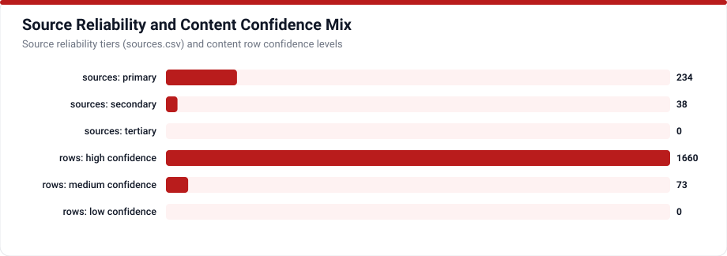
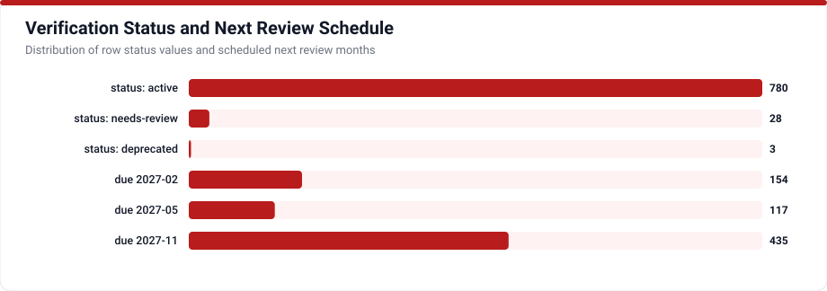

# Evaluation, Observability & Freshness

Reliable agent engineering treats prompts, retrievers, and tool schemas as measurable software artifacts. AI Agent Hub tracks **32 evaluation metrics, testing methods, standard benchmarks, scoring tools, and CI release processes** (`EV-001` through `EV-032`).

## Designing an Agent Evaluation Stack

1. **Measure Stochastic Consistency (`EV-002`)**: Single runs flatter agents; track repeated-trial reliability metrics such as `pass^k` across noisy real-world tools (`tau-bench`, [`EV-020`](../data/evaluation.csv)).
2. **Pair Retrieval Diagnostics with End-State Assertions (`EV-011`, `EV-012`)**: Diagnose whether failures originate in chunk precision/recall, hallucinated synthesis, malformed JSON arguments (`EV-005`), or flawed multi-step trajectories (`EV-006`).
3. **Calibrate Automated Judges (`EV-010`, `EV-014`)**: Periodically check LLM-as-judge grading rubrics against blind human domain expert reviews to eliminate calibration drift (`RS-029`).
4. **Automate CI Gating & Canary Comparisons (`EV-031`, `EV-032`)**: Block regressions on golden eval sets before deployment and verify upgrades against production trace replays and shadow traffic.

## Evaluation Directory (`EV-001` to `EV-032`)

<!-- TABLE_EVALUATION:START -->
| ID | Name | Kind | What It Measures | Confidence |
|---|---|---|---|---|
| EV-001 | Task Completion Rate | metric | Fraction of assigned tasks reaching verified goal end-states without fatal exceptions or stalled loops. | high |
| EV-002 | pass^k Reliability Consistency | metric | Probability that an agent solves the exact same task across repeated independent runs despite stochastic sampling variance. | high |
| EV-003 | Faithfulness and Groundedness | metric | Degree to which every factual claim emitted by an agent is directly entailed by retrieved passages or observed tool outputs. | high |
| EV-004 | Context Precision and Recall | metric | Whether RAG retrieval pipelines rank relevant source chunks near the top and avoid omitting crucial supporting facts. | high |
| EV-005 | Tool Call Schema and Argument Accuracy | metric | Correctness of model-selected function names, JSON Schema types, required fields, and semantically valid argument values. | high |
| EV-006 | Trajectory Efficiency and Step Overhead | metric | Comparison between actual tool invocations, redundant retries, and total tokens consumed versus optimal task paths. | high |
| EV-007 | Citation Attribution Precision | metric | Accuracy with which inline source links and footnote snippets genuinely support the claims they accompany. | high |
| EV-008 | Adversarial Attack Success Rate | metric | Proportion of simulated prompt-injection, jailbreak, or data-exfiltration probes that bypass agent guardrails or authorization boundaries. | high |
| EV-009 | Response Latency and Time-to-First-Token | metric | Interactive responsiveness covering initial token streaming onset alongside full multi-turn completion duration across tool runs. | high |
| EV-010 | LLM-as-a-Judge Rubric Grading | method | Qualitative scoring methodology applying calibrated evaluator models with explicit rubrics or blind pairwise comparison across candidate runs. | high |
| EV-011 | RAG Triad Diagnostic Method | method | Structured diagnostic decomposition scoring query-context relevance, context-response groundedness, and query-response answer relevance jointly. | high |
| EV-012 | Deterministic State and Unit Verification | method | Validating agent effectiveness strictly via objective end-state checks such as database rows, compiled builds, unit tests, and typed schemas. | high |
| EV-013 | Simulated User and Policy Interaction Method | method | Testing conversational agents against persona-driven LLM user simulators within stateful policy and tool sandboxes. | high |
| EV-014 | Blind Human Expert Calibration | method | Structured domain expert review of sampled agent traces to establish gold datasets and audit automated judge alignment. | high |
| EV-015 | Long-Term Conversational Memory Recall Evaluation | method | Evaluating whether memory-augmented agents retrieve and apply facts introduced across distant past sessions accurately. | high |
| EV-016 | Holistic Multi-Dimension Evaluation (HELM) | method | Evaluating language systems concurrently across accuracy, calibration, robustness, fairness, toxicity, bias, and efficiency rather than single scores. | high |
| EV-017 | SWE-bench | benchmark | Real-world software engineering benchmark measuring whether coding agents resolve verified open-source GitHub repository issues. | high |
| EV-018 | GAIA General AI Assistants Benchmark | benchmark | Evaluation benchmark testing generalist assistants across realistic multi-step tasks combining reasoning, multimodal reading, browsing, and tool use. | high |
| EV-019 | OSWorld | benchmark | Real computer environment benchmark assessing multimodal agents across Ubuntu and Windows desktop applications, browsers, shells, and office tools. | high |
| EV-020 | tau-bench (Tool-Agent-User Benchmark) | benchmark | Interactive domain benchmark testing conversational customer-service agents over dynamic APIs, database rules, and simulated human users. | high |
| EV-021 | WebArena | benchmark | Self-hosted realistic web environment benchmark featuring functional e-commerce, forum, GitLab, and CMS apps for browser agents. | high |
| EV-022 | AgentBench | benchmark | Multi-environment agent benchmark spanning operating systems, SQL databases, knowledge graphs, web interactions, and embodied reasoning tasks. | high |
| EV-023 | Berkeley Function Calling Leaderboard (BFCL) | benchmark | Tool-calling evaluation suite measuring syntactic schema validity, parameter typing, parallel invocation, irrelevance detection, and multi-turn execution. | high |
| EV-024 | MT-Bench | benchmark | Multi-turn instruction-following benchmark assessing conversational coherence, reasoning, coding, and writing evaluated via LLM judges and human preferences. | high |
| EV-025 | HumanEval | benchmark | Functional correctness benchmark assessing standalone Python function synthesis from docstrings against hidden unit-test assertions. | high |
| EV-026 | MMLU and BIG-Bench | benchmark | Broad multitask knowledge and capability benchmark suites covering STEM, humanities, professional domains, and tricky reasoning tasks. | high |
| EV-027 | Ragas Evaluation Framework | tool | Open-source Python evaluation toolkit providing reference-free RAG and agentic metrics spanning faithfulness, context recall, and tool checks. | high |
| EV-028 | DeepEval Unit-Testing Suite | tool | Pytest-integrated LLM evaluation framework for running conversational, RAG, hallucination, and agentic safety assertions inside developer workflows. | high |
| EV-029 | TruLens Feedback and Trace Evaluation | tool | Observability and feedback-function library built around OpenTelemetry spans and the RAG Triad evaluation workflow. | high |
| EV-030 | OpenAI Evals and Braintrust Scoring Harnesses | tool | Hosted and SDK evaluation harnesses linking versioned test datasets, programmatic scorers, human review queues, and side-by-side prompt diffs. | high |
| EV-031 | CI Prompt and Model Regression Gating | process | Automated release workflow executing critical behavioral, schema, citation, and latency evals prior to merging prompt or model changes. | high |
| EV-032 | Adversarial Red-Teaming and Canary Auditing | process | Scheduled security probing paired with shadow/canary telemetry monitoring to catch emergent jailbreaks, drift, and real-world regressions. | high |
<!-- TABLE_EVALUATION:END -->
