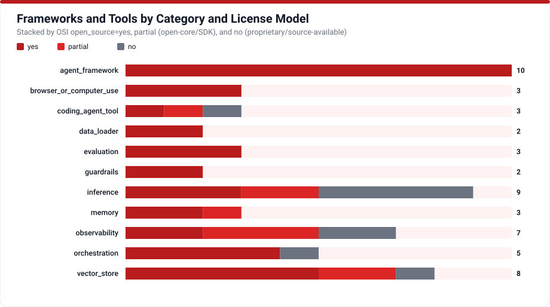

# AI Agent Frameworks & Ecosystem Tooling

AI Agent Hub tracks **55 frameworks, orchestration engines, vector databases, observability tracers, evaluation suites, guardrail runtimes, memory layers, inference proxies, sandboxes, and ingestion libraries** (`FW-001` through `FW-055`). Each entry audits exact OSS licensing, supported protocols, maintainer status, and historical deprecations (such as legacy Phidata `FW-012` superseded by Agno `FW-010`, and the retired OpenAI Assistants API `FW-013`).

## Architectural Selection Guidelines

- **Keep Control Explicit**: Thin SDK loops or explicit state graphs ([`FW-002`](https://docs.langchain.com/oss/python/langgraph/overview), [`FW-009`](https://pydantic.dev/docs/ai/overview/)) minimize hidden prompt mutations relative to opaque high-level wrappers.
- **Avoid Lock-In**: Favor open wire standards ([MCP](protocols.md), [OpenTelemetry](protocols.md), OpenAI-compatible HTTP interfaces) so underlying LLM providers and tracers remain replaceable.
- **Check Commercial Clauses Carefully**: Open-weights or source-available repositories (such as Elastic License 2.0 on `FW-026` or proprietary control planes inside open-core enterprise tiers) carry operational constraints captured explicitly in the table below.

## Complete Frameworks & Tooling Catalog (`FW-001` to `FW-055`)

<!-- TABLE_FRAMEWORKS:START -->
| ID | Name | Category | License | Open Source | Status |
|---|---|---|---|---|---|
| FW-001 | [LangChain](https://docs.langchain.com/oss/python/langchain/overview) | agent_framework | MIT | yes | active |
| FW-002 | [LangGraph](https://docs.langchain.com/oss/python/langgraph/overview) | orchestration | MIT | yes | active |
| FW-003 | [LlamaIndex](https://developers.llamaindex.ai/python/framework/) | agent_framework | MIT | yes | active |
| FW-004 | [AutoGen](https://microsoft.github.io/autogen/stable/) | orchestration | MIT (code) / CC-BY-4.0 (docs) | yes | active |
| FW-005 | [CrewAI](https://docs.crewai.com) | agent_framework | MIT | yes | active |
| FW-006 | [Semantic Kernel](https://learn.microsoft.com/en-us/semantic-kernel/overview/) | agent_framework | MIT | yes | active |
| FW-007 | [Haystack](https://docs.haystack.deepset.ai/docs/intro) | agent_framework | Apache-2.0 | yes | active |
| FW-008 | [DSPy](https://dspy.ai/current/) | agent_framework | MIT | yes | active |
| FW-009 | [PydanticAI](https://pydantic.dev/docs/ai/overview/) | agent_framework | MIT | yes | active |
| FW-010 | [Agno](https://docs.agno.com) | agent_framework | Apache-2.0 | yes | active |
| FW-011 | [smolagents](https://huggingface.co/docs/smolagents/index) | agent_framework | Apache-2.0 | yes | active |
| FW-012 | [Phidata](https://docs.phidata.com/introduction) | agent_framework | Mozilla Public License 2.0 | yes | deprecated |
| FW-013 | [OpenAI Assistants API](https://developers.openai.com/api/docs/assistants/migration) | orchestration | Proprietary | no | deprecated |
| FW-014 | [Prefect](https://www.prefect.io/docs/v3/get-started) | orchestration | Apache-2.0 | yes | active |
| FW-015 | [Temporal](https://docs.temporal.io) | orchestration | MIT | yes | active |
| FW-016 | [Pinecone](https://docs.pinecone.io/guides/get-started/overview) | vector_store | Proprietary | no | active |
| FW-017 | [Weaviate](https://docs.weaviate.io/weaviate) | vector_store | BSD-3-Clause (core) / Proprietary (enterprise) | partial | active |
| FW-018 | [Chroma](https://docs.trychroma.com/docs/overview/introduction) | vector_store | Apache-2.0 | yes | active |
| FW-019 | [Qdrant](https://qdrant.tech/documentation/) | vector_store | Apache-2.0 | yes | active |
| FW-020 | [Milvus](https://milvus.io/docs) | vector_store | Apache-2.0 | yes | active |
| FW-021 | [pgvector](https://github.com/pgvector/pgvector) | vector_store | PostgreSQL License | yes | active |
| FW-022 | [Redis Vector](https://redis.io/docs/latest/develop/ai/search-and-query/vectors/) | vector_store | AGPLv3 / RSALv2 / SSPLv1 (Redis 8 tri-license) | partial | active |
| FW-023 | [OpenSearch kNN](https://docs.opensearch.org/latest/search-plugins/knn/) | vector_store | Apache-2.0 | yes | active |
| FW-024 | [LangSmith](https://docs.langchain.com/langsmith/observability) | observability | Proprietary | no | active |
| FW-025 | [Weights & Biases](https://docs.coreweave.com/forge-home) | observability | MIT (client SDK) / Proprietary (platform) | partial | active |
| FW-026 | [Arize Phoenix](https://arize.com/docs/phoenix) | observability | Elastic License 2.0 (ELv2) | no | active |
| FW-027 | [Langfuse](https://langfuse.com/docs) | observability | MIT (core) / Proprietary (ee/ enterprise) | partial | active |
| FW-028 | [AgentOps](https://docs.agentops.ai/v2/introduction) | observability | MIT | yes | active |
| FW-029 | [Helicone](https://docs.helicone.ai/getting-started/quick-start) | observability | Apache-2.0 | yes | active |
| FW-030 | [Braintrust](https://docs.braintrust.dev/) | observability | Apache-2.0 (SDKs) / Proprietary (platform) | partial | active |
| FW-031 | [Ragas](https://docs.ragas.io/en/stable/) | evaluation | Apache-2.0 | yes | active |
| FW-032 | [TruLens](https://www.trulens.org/docs/) | evaluation | MIT | yes | active |
| FW-033 | [DeepEval](https://deepeval.com/) | evaluation | Apache-2.0 | yes | active |
| FW-034 | [Guardrails AI](https://github.com/guardrails-ai/guardrails/tree/main/docs) | guardrails | Apache-2.0 | yes | active |
| FW-035 | [NeMo Guardrails](https://docs.nvidia.com/nemo/guardrails/about-nemo-guardrails-library/overview) | guardrails | Apache-2.0 | yes | active |
| FW-036 | [Mem0](https://github.com/mem0ai/mem0) | memory | Apache-2.0 | yes | active |
| FW-037 | [Zep](https://help.getzep.com/overview) | memory | Apache-2.0 (Graphiti and SDKs) / Proprietary (Zep Cloud) | partial | active |
| FW-038 | [LangMem](https://langchain-ai.github.io/langmem) | memory | MIT | yes | active |
| FW-039 | [vLLM](https://docs.vllm.ai/en/latest/) | inference | Apache-2.0 | yes | active |
| FW-040 | [Ollama](https://github.com/ollama/ollama) | inference | MIT | yes | active |
| FW-041 | [LiteLLM](https://docs.litellm.ai) | inference | MIT (core) / Proprietary (enterprise/) | partial | active |
| FW-042 | [Groq](https://console.groq.com/docs/overview) | inference | Proprietary | no | active |
| FW-043 | [Together AI](https://docs.together.ai/intro) | inference | Proprietary | no | active |
| FW-044 | [Fireworks AI](https://docs.fireworks.ai/getting-started/introduction) | inference | Proprietary | no | active |
| FW-045 | [Replicate](https://replicate.com/docs) | inference | Proprietary | no | active |
| FW-046 | [Modal](https://modal.com/docs) | inference | Apache-2.0 (client SDK) / Proprietary (cloud platform) | partial | active |
| FW-047 | [Browser Use](https://github.com/browser-use/browser-use) | browser_or_computer_use | MIT | yes | active |
| FW-048 | [Playwright](https://playwright.dev/docs/intro) | browser_or_computer_use | Apache-2.0 | yes | active |
| FW-049 | [E2B](https://docs.e2b.dev/) | browser_or_computer_use | Apache-2.0 | yes | active |
| FW-050 | [Composio](https://docs.composio.dev/docs) | coding_agent_tool | MIT (SDK) / Proprietary (hosted cloud) | partial | active |
| FW-051 | [Instructor](https://python.useinstructor.com) | coding_agent_tool | MIT | yes | active |
| FW-052 | [LangChain Hub](https://smith.langchain.com/hub) | coding_agent_tool | Proprietary (LangSmith Terms) | no | active |
| FW-053 | [Unstructured](https://docs.unstructured.io/transform/first-request) | data_loader | Apache-2.0 | yes | active |
| FW-054 | [LlamaHub](https://developers.llamaindex.ai/python/framework/) | data_loader | MIT | yes | deprecated |
| FW-055 | [BentoML](https://docs.bentoml.com/en/latest/) | inference | Apache-2.0 | yes | active |
<!-- TABLE_FRAMEWORKS:END -->

Full selection notes (`best_for`, `not_ideal_for`, maintainers, and primary docs/repo citations) live in [`data/frameworks_tools.csv`](../data/frameworks_tools.csv).
