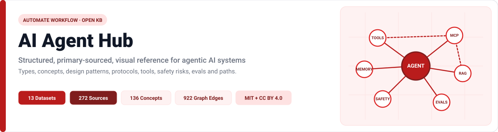

# Documentation Index

Welcome to the curated reference guides of **AI Agent Hub**. Every table, count, and item page below is deterministically built from the relational CSV catalog in [`data/`](../data/README.md) and verified against 272 cataloged sources.

## Core Architecture & Knowledge Guides

| Guide | Focus | Key Visuals |
|---|---|---|
| [Architecture of an Agent](architecture-of-an-agent.md) | Runtime anatomy, ReAct execution loops, autonomy tiers, and RAG grounding | `agent-anatomy.svg`, `agent-loop.svg`, Mermaid sequences |
| [Agent Types](agent-types.md) | Taxonomy of 40 agent types across Decision Logic, Job Roles, and System Architectures | `agent-landscape.svg`, `agent-types-breakdown.svg` |
| [Core Concepts](concepts.md) | Deep glossary and dependency map spanning 136 concepts across 11 pillars | `concept-map.svg`, `concepts-by-category.svg`, 11 icons |
| [Design Patterns](patterns.md) | 35 reusable execution, retrieval, memory, quality, safety, and orchestration patterns | `patterns-overview.svg`, `multi-agent-topologies.svg`, `decision-tree.svg` |
| [Open Protocols & Standards](protocols.md) | 16 transport, schema, auth, tool (MCP), agent (A2A), commerce, and governance specs | `protocol-stack.svg`, MCP/A2A Mermaid sequence |
| [Frameworks & Tooling](frameworks.md) | 55 orchestration SDKs, vector stores, observability tracers, eval suites, and sandboxes | `frameworks-by-category-oss.svg` |
| [Industry Use Cases](use-cases.md) | 83 sector workloads mapping patterns, risks, and human oversight levels | `use-cases-by-industry.svg` |
| [Safety, Security & Governance](security.md) | 42 risks (OWASP LLM/Agentic Top 10, MITRE ATLAS, NIST, EU AI Act) and controls | `security-layers.svg`, `risk-heatmap.svg` |
| [Evaluation & Operations](evaluation.md) | 32 metrics, benchmarks (`SWE-bench`, `GAIA`, `tau-bench`), graders, and CI checks | `freshness-status.svg`, `source-reliability-confidence.svg` |
| [Learning Paths & Resources](learning-paths.md) | 105 guided curriculum steps across 5 role tracks plus 267 vetted resources | `learning-roadmap.svg` |

## Methodology, Operations & Governance

| Document | Purpose |
|---|---|
| [How to Read This Hub](how-to-read-this-hub.md) | Practical orientation for reading schemas, confidence tiers, and badges |
| [Evidence Methodology](methodology.md) | Primary-source rules, citation calibration, and qualitative prose standards |
| [Maintenance & Freshness](maintenance.md) | Review windows (`90`/`180`/`365` days), link checking, and lifecycle policies |
| [Architecture Decisions](decisions.md) | Key technical decisions (`DEC-001` through `DEC-006`) recorded during development |
| [Data Dictionary](../data/README.md) | Column definitions and JSON Schema constraints across all 13 CSV tables |
