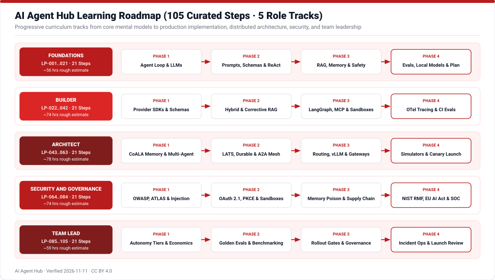

# Guided Learning Paths & Curated Resources

AI Agent Hub structures **105 sequential curriculum steps** (`LP-001` through `LP-105`) across **5 tailored tracks** supported by **267 verified resources** (`RES-001` through `RES-267` spanning official specifications, papers, books, university courses, open-source repositories, tools, videos, docs, and newsletters).

> **Note on Study Times**: The `estimated_hours` figures shown below are rough self-study estimates intended only to help learners plan pacing across modules.

## Difficulty & Verification Legends

| Difficulty Tiers | Lifecycle Status |
|---|---|
|  Foundational mental models |  Verified against sources |
|  Hands-on implementation |  Scheduled review / secondary |
|  Production systems & research |  Superseded / retired artifact |

## Choose Your Track

- **Foundations (`LP-001`..`LP-021`)**: Agent loop, LLMs, structured outputs, ReAct, MCP basics, RAG, security awareness, and eval essentials.
- **Builder (`LP-022`..`LP-042`)**: Provider SDKs, Pydantic validation, hybrid RAG, LangGraph checkpoints, sandboxes, custom MCP servers, OTel tracing, and CI evals.
- **Architect (`LP-043`..`LP-063`)**: CoALA cognitive memory, supervisor/swarm topologies, LATS search, Temporal durability, A2A meshes, vLLM, routing, and canary rollouts.
- **Security and Governance (`LP-064`..`LP-084`)**: OWASP LLM & Agentic Top 10, MITRE ATLAS, indirect injection defense, OAuth 2.1 / PKCE, microVMs, vector ACLs, NIST RMF, EU AI Act, and SOC readiness.
- **Team Lead (`LP-085`..`LP-105`)**: Scripts vs workflows vs agents, autonomy tiers, token economics, golden eval specs, judge calibration, open-weight tradeoffs, and go-live governance.

## Complete 105-Step Curriculum Table

<!-- TABLE_LEARNING_PATHS:START -->
| ID | Path | Step | Title | Est. Hours | Confidence |
|---|---|---|---|---|---|
| LP-043 | Architect | 1 | System Decomposition: Workflows vs Autonomy | 3.0 | high |
| LP-044 | Architect | 2 | Cognitive Architectures and CoALA Memory Design | 4.0 | high |
| LP-045 | Architect | 3 | Orchestrator-Worker and Supervisor Topologies | 3.5 | high |
| LP-046 | Architect | 4 | Decentralized Handoffs, Swarms, and Multi-Agent Debate | 3.5 | high |
| LP-047 | Architect | 5 | Long-Horizon Planning and Tree Search Architectures | 4.0 | high |
| LP-048 | Architect | 6 | Episodic Reflection and Reusable Skill Libraries | 3.5 | high |
| LP-049 | Architect | 7 | Durable Execution and Asynchronous Background Agents | 4.5 | high |
| LP-050 | Architect | 8 | Agent2Agent (A2A) Interoperability and Agent Cards | 3.5 | high |
| LP-051 | Architect | 9 | Enterprise Tool Registries and Schema-First Generation | 3.5 | high |
| LP-052 | Architect | 10 | Enterprise Retrieval: Scale, Sharding, and Knowledge Graphs | 4.0 | high |
| LP-053 | Architect | 11 | Model Routing and Compact SLM Cascades | 3.5 | high |
| LP-054 | Architect | 12 | Inference Systems: vLLM, Attention, and Speculative Decoding | 4.0 | high |
| LP-055 | Architect | 13 | API Gateways, Semantic Caching, and Resilience | 3.5 | high |
| LP-056 | Architect | 14 | Strategic Model Adaptation: Fine-Tuning and LoRA | 4.0 | high |
| LP-057 | Architect | 15 | Cloud-Native Agent Platforms vs Self-Hosted Stacks | 3.0 | high |
| LP-058 | Architect | 16 | Multimodal, Robotics, and High-Context Architectures | 3.5 | high |
| LP-059 | Architect | 17 | Evaluation Harnesses: Trajectories and Simulation Sandboxes | 4.0 | high |
| LP-060 | Architect | 18 | Engineering Reliability Under Non-Determinism | 3.5 | high |
| LP-061 | Architect | 19 | Progressive Delivery: Shadow Testing and Canary Rollouts | 3.0 | high |
| LP-062 | Architect | 20 | Identity Federation and Agentic Commerce Architecture | 3.5 | high |
| LP-063 | Architect | 21 | Architect Capstone: Enterprise Multi-Agent Blueprint | 6.0 | high |
| LP-022 | Builder | 1 | Developer Setup and Provider SDKs | 2.5 | high |
| LP-023 | Builder | 2 | Type-Safe Structured Extraction with Pydantic | 3.0 | high |
| LP-024 | Builder | 3 | Writing Production Tool Schemas and Loops | 3.5 | high |
| LP-025 | Builder | 4 | Designing Agent-Facing APIs and Tools | 2.5 | high |
| LP-026 | Builder | 5 | Context Management: Compaction and Clearing | 3.0 | high |
| LP-027 | Builder | 6 | Document Parsing, Chunking, and Ingestion | 3.5 | high |
| LP-028 | Builder | 7 | Vector Databases and Hybrid Search Pipelines | 4.0 | high |
| LP-029 | Builder | 8 | Neural Reranking and Corrective RAG | 3.5 | high |
| LP-030 | Builder | 9 | Prompt Chaining, Routing, and Haystack Pipelines | 3.0 | high |
| LP-031 | Builder | 10 | Stateful Graph Workflows with LangGraph | 4.0 | high |
| LP-032 | Builder | 11 | Human Interrupts and Approval Gate Code | 3.0 | high |
| LP-033 | Builder | 12 | Implementing Persistent Cross-Session Memory | 3.5 | high |
| LP-034 | Builder | 13 | Sandboxed Code Execution in MicroVMs | 3.5 | high |
| LP-035 | Builder | 14 | Building and Consuming MCP Servers | 4.0 | high |
| LP-036 | Builder | 15 | Browser Automation and GUI Agents | 3.5 | high |
| LP-037 | Builder | 16 | Multi-Agent Teams with CrewAI, AutoGen, and Agno | 4.0 | high |
| LP-038 | Builder | 17 | Voice and Streaming WebSocket Agents | 3.5 | high |
| LP-039 | Builder | 18 | Input/Output Rails and Programmatic Optimization | 4.0 | high |
| LP-040 | Builder | 19 | Observability Tracing with OpenTelemetry and Langfuse | 3.5 | high |
| LP-041 | Builder | 20 | CI Regression Evals with Ragas and DeepEval | 3.5 | high |
| LP-042 | Builder | 21 | Builder Capstone: Tested Production Agent | 6.0 | high |
| LP-001 | Foundations | 1 | What Is an AI Agent? | 2.0 | high |
| LP-002 | Foundations | 2 | Autonomy Levels and Rational Utility | 2.0 | high |
| LP-003 | Foundations | 3 | How Large Language Models Work | 3.0 | high |
| LP-004 | Foundations | 4 | Instruction Hierarchy and System Prompts | 2.5 | high |
| LP-005 | Foundations | 5 | Structured Outputs and JSON Schema | 2.0 | high |
| LP-006 | Foundations | 6 | Chain-of-Thought and Deliberate Reasoning | 2.5 | high |
| LP-007 | Foundations | 7 | The ReAct Thought-Action-Observation Loop | 2.5 | high |
| LP-008 | Foundations | 8 | Tool Calling and Action Contracts | 3.0 | high |
| LP-009 | Foundations | 9 | Context Engineering Fundamentals | 2.5 | high |
| LP-010 | Foundations | 10 | Model Context Protocol (MCP) Basics | 2.5 | high |
| LP-011 | Foundations | 11 | Embeddings and Vector Similarity Search | 2.5 | high |
| LP-012 | Foundations | 12 | Retrieval-Augmented Generation (RAG) Essentials | 3.5 | high |
| LP-013 | Foundations | 13 | Grounding, Citations, and Hallucination Control | 2.5 | high |
| LP-014 | Foundations | 14 | Short-Term, Long-Term, and Episodic Memory | 3.0 | high |
| LP-015 | Foundations | 15 | Prompt Chaining, Routing, and Agent Workflows | 2.5 | high |
| LP-016 | Foundations | 16 | Core Threat Model: Prompt Injection and Data Leaks | 3.0 | high |
| LP-017 | Foundations | 17 | Human-in-the-Loop and Approval Gates | 2.0 | high |
| LP-018 | Foundations | 18 | Evaluating Agents Beyond Intuition | 3.0 | high |
| LP-019 | Foundations | 19 | Multimodal, Browser, and Voice Interfaces | 2.5 | high |
| LP-020 | Foundations | 20 | Open-Weights Models and Local Inference | 2.5 | high |
| LP-021 | Foundations | 21 | Foundations Capstone: Architecture Walkthrough | 4.0 | high |
| LP-064 | Security and Governance | 1 | Agentic Security Threat Modeling Foundations | 3.0 | high |
| LP-065 | Security and Governance | 2 | OWASP LLM Top 10 and Agentic Top 10 (ASI01-ASI10) | 3.5 | high |
| LP-066 | Security and Governance | 3 | MITRE ATLAS and NIST Adversarial ML Taxonomy | 3.5 | high |
| LP-067 | Security and Governance | 4 | Indirect Prompt Injection Defense Patterns | 3.5 | high |
| LP-068 | Security and Governance | 5 | Input Moderation, Output Validation, and Dialogue Rails | 4.0 | high |
| LP-069 | Security and Governance | 6 | Sandboxing Untrusted Code, CLI, and Browser Actions | 3.5 | high |
| LP-070 | Security and Governance | 7 | Least Privilege, Action Bounds, and Permission Scopes | 3.0 | high |
| LP-071 | Security and Governance | 8 | Delegated Tool Auth: OAuth 2.1, PKCE, and MCP Security | 4.0 | high |
| LP-072 | Security and Governance | 9 | Cryptographic Agent Identity and User Delegation | 3.5 | high |
| LP-073 | Security and Governance | 10 | Secrets Management and Data Exfiltration Controls | 3.0 | high |
| LP-074 | Security and Governance | 11 | Human-in-the-Loop Governance and Approval Gates | 3.0 | high |
| LP-075 | Security and Governance | 12 | Immutable Audit Trails and Forensics Telemetry | 3.5 | high |
| LP-076 | Security and Governance | 13 | Securing RAG Corpora and Vector Embedding Privacy | 3.5 | high |
| LP-077 | Security and Governance | 14 | Defending Long-Term Memory Against Poisoning | 3.5 | high |
| LP-078 | Security and Governance | 15 | Agentic Skill and Plugin Supply-Chain Risk | 3.0 | high |
| LP-079 | Security and Governance | 16 | Alignment Safety: Constitutional AI and Inner Alignment | 3.5 | high |
| LP-080 | Security and Governance | 17 | Automated Red Teaming and Security Evaluation Suites | 4.0 | high |
| LP-081 | Security and Governance | 18 | NIST AI RMF and Generative AI Risk Profile | 3.5 | high |
| LP-082 | Security and Governance | 19 | EU AI Act Compliance for Agentic Deployments | 3.5 | high |
| LP-083 | Security and Governance | 20 | ISO/IEC 42001 AI Management Systems and Acceptable Use | 3.0 | high |
| LP-084 | Security and Governance | 21 | Security Capstone: Production Readiness Signoff | 5.5 | high |
| LP-085 | Team Lead | 1 | Distinguishing Value: Scripts vs Workflows vs Agents | 2.0 | high |
| LP-086 | Team Lead | 2 | Setting Autonomy Tiers and Risk Appetite | 2.5 | high |
| LP-087 | Team Lead | 3 | Build vs Buy vs Framework Selection Strategy | 3.0 | high |
| LP-088 | Team Lead | 4 | AI Unit Economics: Token Cost, Latency, and Routing | 3.0 | high |
| LP-089 | Team Lead | 5 | Structuring Cross-Functional Agent Engineering Teams | 2.5 | high |
| LP-090 | Team Lead | 6 | Owning Golden Evaluation Sets as Product Specs | 3.0 | high |
| LP-091 | Team Lead | 7 | Calibrating LLM-as-Judge Against Domain SMEs | 2.5 | high |
| LP-092 | Team Lead | 8 | Selecting Meaningful Internal and Public Benchmarks | 3.0 | high |
| LP-093 | Team Lead | 9 | Operationalizing NIST, EU AI Act, and ISO 42001 | 3.0 | high |
| LP-094 | Team Lead | 10 | Data Privacy, Vendor Policies, and Vector Governance | 2.5 | high |
| LP-095 | Team Lead | 11 | Human Escalation UX and Review Operations | 2.5 | high |
| LP-096 | Team Lead | 12 | Managing Stochastic Reliability and Fallbacks | 3.0 | high |
| LP-097 | Team Lead | 13 | Production KPIs: Observability, Replay, and Cost Dashboards | 3.0 | high |
| LP-098 | Team Lead | 14 | Prompt, Tool, and Evaluation Versioning Discipline | 2.5 | high |
| LP-099 | Team Lead | 15 | Progressive Rollout: Offline to Shadow to Canary | 3.0 | high |
| LP-100 | Team Lead | 16 | Preventing Vendor Lock-In with Open Standards | 3.0 | high |
| LP-101 | Team Lead | 17 | Frontier APIs vs Open-Weights Self-Hosting Strategy | 3.0 | high |
| LP-102 | Team Lead | 18 | Investment Sequencing: Prompting, RAG, or Fine-Tuning | 2.5 | high |
| LP-103 | Team Lead | 19 | Incident Response, Kill-Switches, and DevOps Operations | 3.0 | high |
| LP-104 | Team Lead | 20 | Commercial Agents, Payments, and Executive Reporting | 2.5 | high |
| LP-105 | Team Lead | 21 | Team Lead Capstone: Go-Live Production Readiness Charter | 4.0 | high |
<!-- TABLE_LEARNING_PATHS:END -->

Explore interactive step completion checkboxes and clickable linked resources inside [`site/index.html`](../site/index.html) or inspect [`data/resources.csv`](../data/resources.csv).
