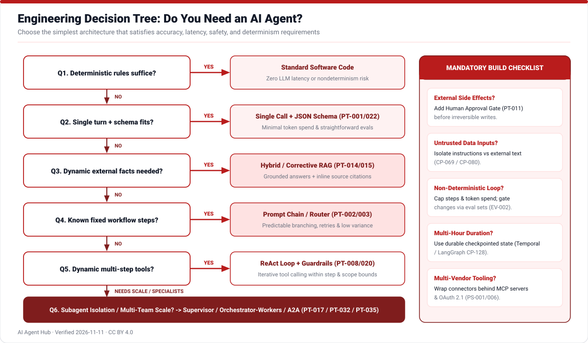
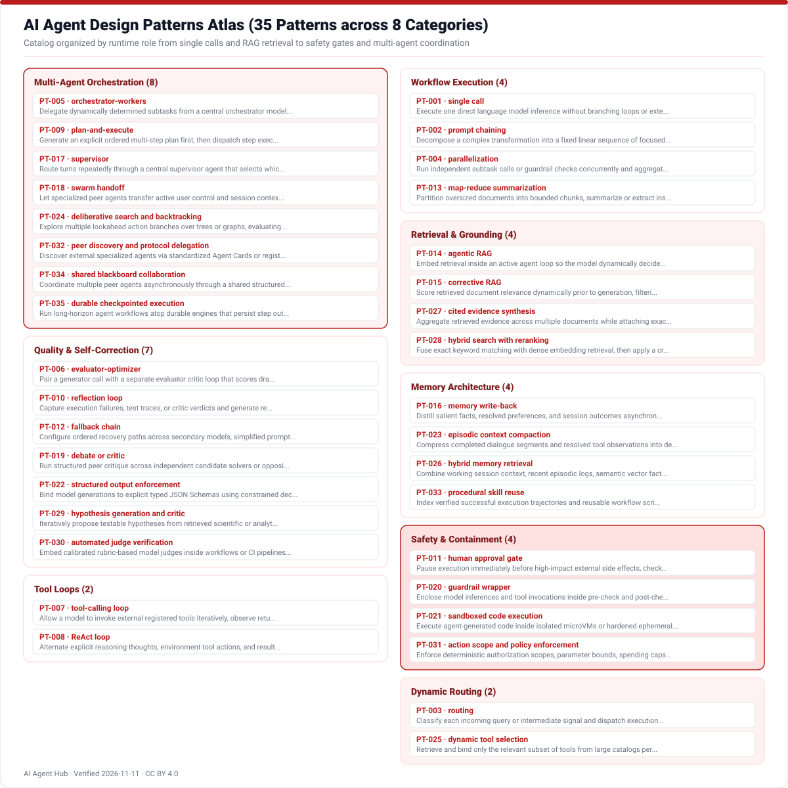
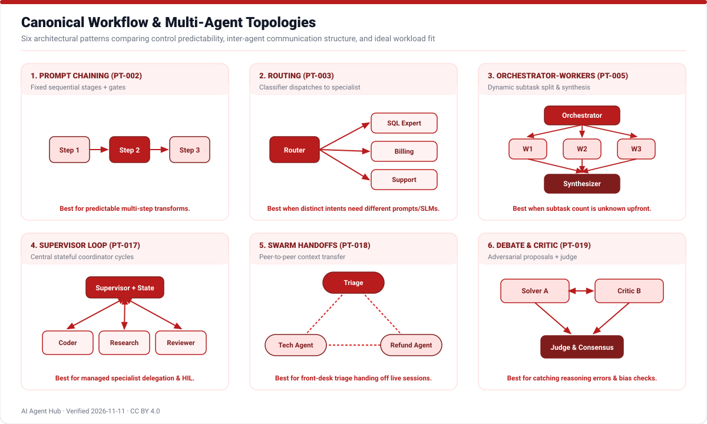

# AI Agent Design Patterns

AI Agent Hub catalogs **35 reusable architectural patterns** (`PT-001` through `PT-035`) spanning deterministic workflow composition, dynamic routing, iterative tool loops, retrieval strategies, memory stores, automated quality verification, runtime safety rails, and multi-agent topologies.

## Complete Patterns Atlas & Topology Visuals

Start with the simplest deterministic pattern that resolves your task reliably before introducing open-ended autonomous loops or multi-agent swarms.

## Pattern Directory (`PT-001` to `PT-035`)

<!-- TABLE_PATTERNS:START -->
| ID | Pattern | Category | Intent | Diagram | Confidence |
|---|---|---|---|---|---|
| PT-001 | single call | workflow | Execute one direct language model inference without branching loops or external tool iterations when a single pass suffices. | [SVG](../diagrams/agent-loop.svg) | high |
| PT-002 | prompt chaining | workflow | Decompose a complex transformation into a fixed linear sequence of focused model calls paired with programmatic gates. | [SVG](../diagrams/multi-agent-topologies.svg) | high |
| PT-003 | routing | routing | Classify each incoming query or intermediate signal and dispatch execution to a specialized downstream prompt, workflow, or model. | [SVG](../diagrams/multi-agent-topologies.svg) | high |
| PT-004 | parallelization | workflow | Run independent subtask calls or guardrail checks concurrently and aggregate results once parallel branches complete. | [SVG](../diagrams/multi-agent-topologies.svg) | high |
| PT-005 | orchestrator-workers | orchestration | Delegate dynamically determined subtasks from a central orchestrator model to specialized worker agents and synthesize their findings. | [SVG](../diagrams/multi-agent-topologies.svg) | high |
| PT-006 | evaluator-optimizer | quality | Pair a generator call with a separate evaluator critic loop that scores drafts against explicit criteria until quality passes or limits trigger. | [SVG](../diagrams/patterns-overview.svg) | high |
| PT-007 | tool-calling loop | tool_loop | Allow a model to invoke external registered tools iteratively, observe returned payloads, and continue looping until producing a final response. | [SVG](../diagrams/agent-loop.svg) | high |
| PT-008 | ReAct loop | tool_loop | Alternate explicit reasoning thoughts, environment tool actions, and resulting observations inside an interpretable iterative cycle. | [SVG](../diagrams/agent-loop.svg) | high |
| PT-009 | plan-and-execute | orchestration | Generate an explicit ordered multi-step plan first, then dispatch step execution sequentially or concurrently with optional replanning. | [SVG](../diagrams/agent-anatomy.svg) | high |
| PT-010 | reflection loop | quality | Capture execution failures, test traces, or critic verdicts and generate reflective diagnostics persisted across retries or episodes. | [SVG](../diagrams/patterns-overview.svg) | high |
| PT-011 | human approval gate | safety | Pause execution immediately before high-impact external side effects, checkpointing full state until an authorized operator approves or rejects. | [SVG](../diagrams/security-layers.svg) | high |
| PT-012 | fallback chain | quality | Configure ordered recovery paths across secondary models, simplified prompts, deterministic rules, or human handoff upon failures. | [SVG](../diagrams/patterns-overview.svg) | high |
| PT-013 | map-reduce summarization | workflow | Partition oversized documents into bounded chunks, summarize or extract insights in parallel (map), and merge findings hierarchically (reduce). | [SVG](../diagrams/patterns-overview.svg) | high |
| PT-014 | agentic RAG | retrieval | Embed retrieval inside an active agent loop so the model dynamically decides whether, how, and across which indices to query and refine searches. | [SVG](../diagrams/rag-pipeline.svg) | high |
| PT-015 | corrective RAG | retrieval | Score retrieved document relevance dynamically prior to generation, filtering bad chunks and triggering query rewrite or external search fallback on low confidence. | [SVG](../diagrams/rag-pipeline.svg) | high |
| PT-016 | memory write-back | memory | Distill salient facts, resolved preferences, and session outcomes asynchronously or post-turn into long-term stores after conflict resolution. | [SVG](../diagrams/agent-anatomy.svg) | high |
| PT-017 | supervisor | orchestration | Route turns repeatedly through a central supervisor agent that selects which specialized subagent acts next and checks overall completion. | [SVG](../diagrams/multi-agent-topologies.svg) | high |
| PT-018 | swarm handoff | orchestration | Let specialized peer agents transfer active user control and session context directly to another peer when domain boundaries shift. | [SVG](../diagrams/multi-agent-topologies.svg) | high |
| PT-019 | debate or critic | quality | Run structured peer critique across independent candidate solvers or opposing roles before a referee synthesizes a vetted conclusion. | [SVG](../diagrams/multi-agent-topologies.svg) | high |
| PT-020 | guardrail wrapper | safety | Enclose model inferences and tool invocations inside pre-check and post-check validation middleware enforcing safety, PII, and schema rules. | [SVG](../diagrams/security-layers.svg) | high |
| PT-021 | sandboxed code execution | safety | Execute agent-generated code inside isolated microVMs or hardened ephemeral containers with strict timeouts, resource caps, and blocked egress. | [SVG](../diagrams/security-layers.svg) | high |
| PT-022 | structured output enforcement | quality | Bind model generations to explicit typed JSON Schemas using constrained decoding or typed retry validation before downstream consumption. | [SVG](../diagrams/agent-anatomy.svg) | high |
| PT-023 | episodic context compaction | memory | Compress completed dialogue segments and resolved tool observations into dense checkpoints before working context fills attention limits. | [SVG](../diagrams/agent-anatomy.svg) | high |
| PT-024 | deliberative search and backtracking | orchestration | Explore multiple lookahead action branches over trees or graphs, evaluating intermediate states and pruning unpromising paths. | [SVG](../diagrams/decision-tree.svg) | high |
| PT-025 | dynamic tool selection | routing | Retrieve and bind only the relevant subset of tools from large catalogs per turn or task using semantic matching or permissions filtering. | [SVG](../diagrams/protocol-stack.svg) | high |
| PT-026 | hybrid memory retrieval | memory | Combine working session context, recent episodic logs, semantic vector facts, and knowledge graphs into unified memory queries per turn. | [SVG](../diagrams/rag-pipeline.svg) | high |
| PT-027 | cited evidence synthesis | retrieval | Aggregate retrieved evidence across multiple documents while attaching exact claim-level source spans and inline provenance tags. | [SVG](../diagrams/rag-pipeline.svg) | high |
| PT-028 | hybrid search with reranking | retrieval | Fuse exact keyword matching with dense embedding retrieval, then apply a cross-encoder reranker to elevate top passages before generation. | [SVG](../diagrams/rag-pipeline.svg) | high |
| PT-029 | hypothesis generation and critic | quality | Iteratively propose testable hypotheses from retrieved scientific or analytical data and challenge each hypothesis against counterfactual checks. | [SVG](../diagrams/patterns-overview.svg) | high |
| PT-030 | automated judge verification | quality | Embed calibrated rubric-based model judges inside workflows or CI pipelines to score responses for faithfulness, completeness, and safety. | [SVG](../diagrams/patterns-overview.svg) | high |
| PT-031 | action scope and policy enforcement | safety | Enforce deterministic authorization scopes, parameter bounds, spending caps, and environment allowlists externally at tool execution boundaries. | [SVG](../diagrams/security-layers.svg) | high |
| PT-032 | peer discovery and protocol delegation | orchestration | Discover external specialized agents via standardized Agent Cards or registries and delegate structured tasks asynchronously across network protocols. | [SVG](../diagrams/protocol-stack.svg) | high |
| PT-033 | procedural skill reuse | memory | Index verified successful execution trajectories and reusable workflow scripts into procedural libraries retrieved by task similarity. | [SVG](../diagrams/agent-anatomy.svg) | high |
| PT-034 | shared blackboard collaboration | orchestration | Coordinate multiple peer agents asynchronously through a shared structured workspace or message board where agents post partial findings and claim tasks. | [SVG](../diagrams/multi-agent-topologies.svg) | high |
| PT-035 | durable checkpointed execution | orchestration | Run long-horizon agent workflows atop durable engines that persist step outcomes, survive process restarts, and resume awaiting human or API events. | [SVG](../diagrams/autonomy-ladder.svg) | high |
<!-- TABLE_PATTERNS:END -->

See [`data/patterns.csv`](../data/patterns.csv) for full structural details, explicit anti-patterns (`when_not_to_use`), tradeoffs, and concrete production examples for every row.
