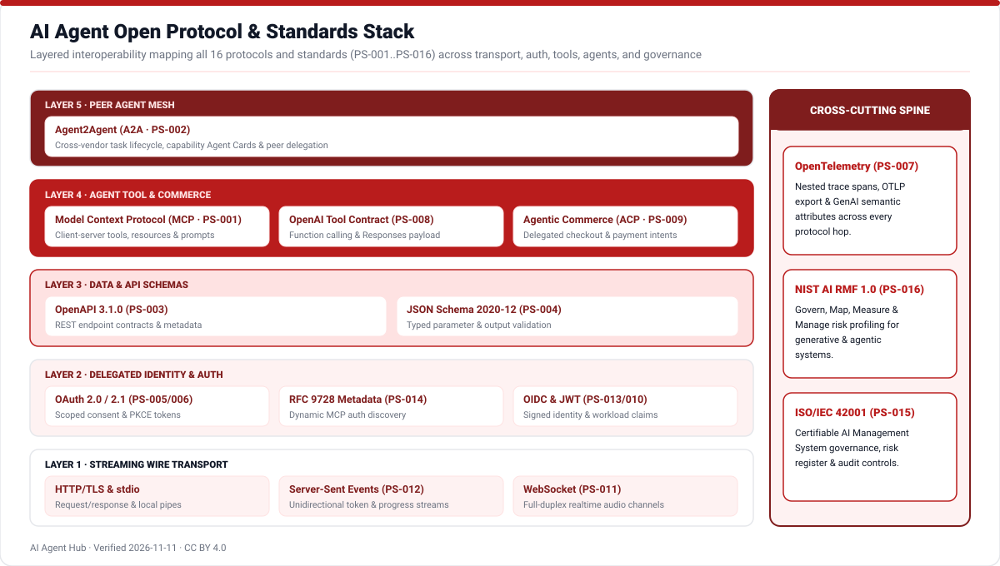
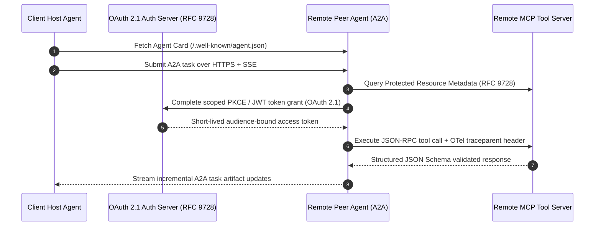

# Open Protocols & Standards Stack

Interoperable agents rely on clear separation between wire transport, delegated OAuth identity, machine-checkable parameter schemas, model-to-tool connectors ([`PS-001`](https://modelcontextprotocol.io/specification/2026-07-28)), and peer agent discovery ([`PS-002`](https://a2a-protocol.org/latest/)).

## End-to-End MCP & A2A Delegation Flow

## Standards & Specifications Directory (`PS-001` to `PS-016`)

<!-- TABLE_PROTOCOLS:START -->
| ID | Name | Kind | Steward | Adoption | Confidence |
|---|---|---|---|---|---|
| PS-001 | [Model Context Protocol (MCP)](https://modelcontextprotocol.io/specification/2026-07-28) | tool_protocol | Model Context Protocol | widespread | high |
| PS-002 | [Agent2Agent Protocol (A2A)](https://a2a-protocol.org/latest/) | agent_protocol | Linux Foundation (A2A Project) | growing | high |
| PS-003 | [OpenAPI Specification 3.1.0](https://spec.openapis.org/oas/v3.1.0) | api_spec | OpenAPI Initiative (Linux Foundation) | widespread | high |
| PS-004 | [JSON Schema (Draft 2020-12)](https://json-schema.org/draft/2020-12/json-schema-validation) | schema_standard | JSON Schema Organization | widespread | high |
| PS-005 | [OAuth 2.0 Authorization Framework (RFC 6749)](https://www.rfc-editor.org/info/rfc6749/) | auth_standard | IETF OAuth Working Group | widespread | high |
| PS-006 | [OAuth 2.1 Authorization Framework (Draft-17)](https://www.ietf.org/archive/id/draft-ietf-oauth-v2-1-17.txt) | auth_standard | IETF OAuth Working Group | growing | high |
| PS-007 | [OpenTelemetry (OTEL)](https://opentelemetry.io/docs/specs/otel) | observability_standard | Cloud Native Computing Foundation (CNCF) | widespread | high |
| PS-008 | [OpenAI Function Calling and Responses API Contract](https://developers.openai.com/api/docs/guides/function-calling) | api_spec | OpenAI | widespread | high |
| PS-009 | [Agentic Commerce Protocol (ACP)](https://www.agenticcommerce.dev/) | commerce_protocol | OpenAI and Stripe | emerging | high |
| PS-010 | [JSON Web Token (JWT, RFC 7519)](https://www.rfc-editor.org/info/rfc7519/) | auth_standard | IETF OAuth Working Group | widespread | high |
| PS-011 | [The WebSocket Protocol (RFC 6455)](https://www.rfc-editor.org/info/rfc6455/) | transport_protocol | IETF HyBi Working Group | widespread | high |
| PS-012 | [Server-Sent Events (SSE)](https://html.spec.whatwg.org/multipage/server-sent-events.html) | transport_protocol | WHATWG | widespread | high |
| PS-013 | [OpenID Connect Core 1.0](https://openid.net/specs/openid-connect-core-1_0.html) | auth_standard | OpenID Foundation | widespread | high |
| PS-014 | [OAuth 2.0 Protected Resource Metadata (RFC 9728)](https://www.rfc-editor.org/info/rfc9728/) | auth_standard | IETF OAuth Working Group | growing | high |
| PS-015 | [ISO/IEC 42001:2023 AI Management System](https://www.iso.org/standard/81230.html) | management_standard | ISO/IEC JTC 1/SC 42 | growing | high |
| PS-016 | [NIST AI Risk Management Framework (AI RMF 1.0)](https://doi.org/10.6028/NIST.AI.100-1) | management_standard | NIST | widespread | high |
<!-- TABLE_PROTOCOLS:END -->

Inspect cross-protocol dependencies and implementing frameworks interactively inside the [Relationship Graph](../site/index.html) or [`data/protocols_standards.csv`](../data/protocols_standards.csv).
