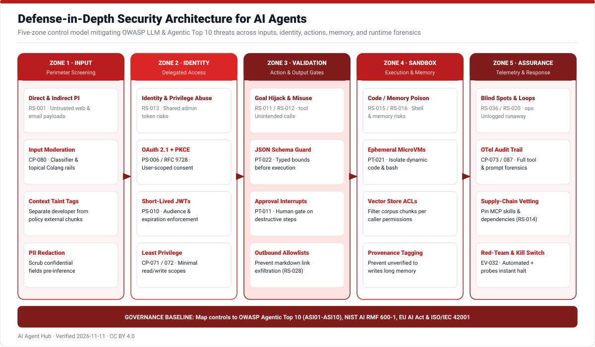
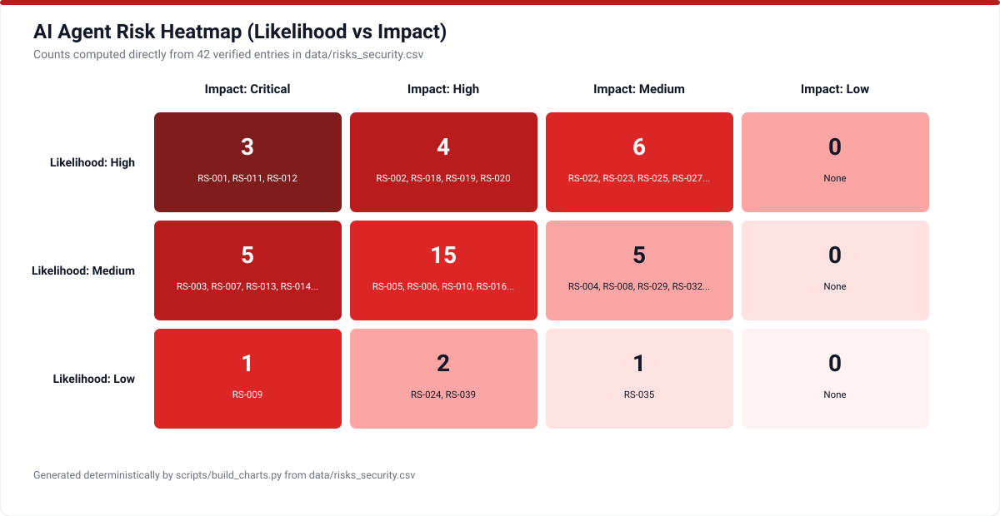
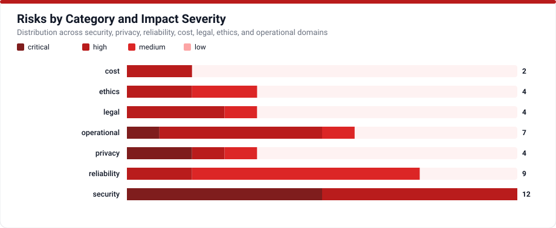
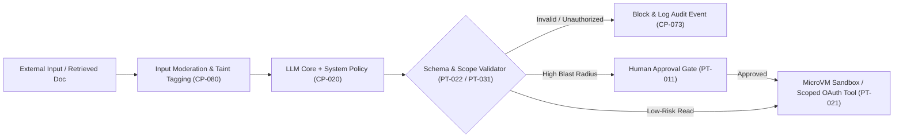

# Safety, Security & Risk Governance

Because AI agents combine natural-language interpretation with external tool privileges and persistent state, traditional AppSec controls alone do not prevent goal hijacking or data exfiltration. AI Agent Hub catalogs **42 distinct risks** (`RS-001` through `RS-042`) incorporating the **OWASP Top 10 for LLM Applications 2025**, **OWASP Top 10 for Agentic Applications (ASI01–ASI10)**, **MITRE ATLAS**, **NIST AI RMF / 600-1 / 100-2e2025**, **EU AI Act**, and **ISO/IEC 42001**.

## Threat-Control Boundary Flow

## Risk & Mitigation Register (`RS-001` to `RS-042`)

<!-- TABLE_RISKS:START -->
| ID | Risk | Category | Likelihood | Impact | Confidence |
|---|---|---|---|---|---|
| RS-001 | Prompt injection (direct and indirect) | security | high | critical | high |
| RS-002 | Factual hallucination and confabulated outputs | reliability | high | high | high |
| RS-003 | Sensitive data and PII exposure | privacy | medium | critical | high |
| RS-004 | Multilingual accuracy and bias disparity | ethics | medium | medium | high |
| RS-005 | Algorithmic bias in employment screening | legal | medium | high | high |
| RS-006 | Regulatory and legal non-compliance error | legal | medium | high | high |
| RS-007 | Protected health data privacy and clinical error | privacy | medium | critical | high |
| RS-008 | Academic grading unfairness and feedback error | ethics | medium | medium | high |
| RS-009 | Industrial safety hazard misreporting | operational | low | critical | high |
| RS-010 | Misleading public-sector citizen guidance | ethics | medium | high | high |
| RS-011 | Agent goal hijack (ASI01) | security | high | critical | high |
| RS-012 | Tool misuse and excessive agency (ASI02) | security | high | critical | high |
| RS-013 | Identity and privilege abuse (ASI03) | security | medium | critical | high |
| RS-014 | Agentic supply chain and skill poisoning (ASI04) | security | medium | critical | high |
| RS-015 | Unexpected code execution and sandbox escape (ASI05) | security | medium | critical | high |
| RS-016 | Long-term memory and context poisoning (ASI06) | security | medium | high | high |
| RS-017 | Insecure inter-agent communication (ASI07) | security | medium | high | high |
| RS-018 | Cascading errors in multi-agent workflows (ASI08) | reliability | high | high | high |
| RS-019 | Automation bias and human approval fatigue (ASI09) | operational | high | high | high |
| RS-020 | Rogue loops and unbounded execution (ASI10) | cost | high | high | high |
| RS-021 | Unbounded token cost and denial of wallet | cost | medium | high | high |
| RS-022 | System prompt and proprietary logic leakage | privacy | high | medium | high |
| RS-023 | Vector store poisoning and stale corpus drift | reliability | high | medium | high |
| RS-024 | Embedding inversion privacy attack | privacy | low | high | high |
| RS-025 | Non-deterministic regression across model updates | reliability | high | medium | high |
| RS-026 | Non-idempotent retry duplication | operational | medium | high | high |
| RS-027 | Context rot and middle-context attention loss | reliability | high | medium | high |
| RS-028 | Markdown and external link exfiltration | security | medium | high | high |
| RS-029 | Unvetted LLM-as-judge calibration drift | reliability | medium | medium | high |
| RS-030 | Schema validation bypass and malformed arguments | reliability | high | medium | high |
| RS-031 | Upstream inference provider outage or throttling | operational | medium | high | high |
| RS-032 | Benchmark contamination and overfitting | reliability | medium | medium | high |
| RS-033 | Reward hacking and metric gaming | security | medium | high | high |
| RS-034 | Sycophancy and policy boundary erosion | reliability | medium | medium | high |
| RS-035 | Copyright and confidential training memorization | legal | low | medium | high |
| RS-036 | Missing observability and forensics blind spots | operational | high | medium | high |
| RS-037 | Shadow AI and ungoverned agent deployment | operational | medium | high | high |
| RS-038 | Browser and GUI hijacking via spoofed overlays | security | medium | high | high |
| RS-039 | Voice spoofing and audio injection attack | security | low | high | high |
| RS-040 | Inaccurate disclosure and transparency failure | legal | medium | high | high |
| RS-041 | Toxic, harassing, or unsafe generated content | ethics | medium | high | high |
| RS-042 | API deprecation and unpinned dependency breakage | operational | medium | high | high |
<!-- TABLE_RISKS:END -->

Inspect exact mitigation mappings (`mitigates` edges) connecting concrete patterns, protocols, and guardrails to each `RS-*` ID in [`data/relationships.csv`](../data/relationships.csv) or [`data/risks_security.csv`](../data/risks_security.csv).
