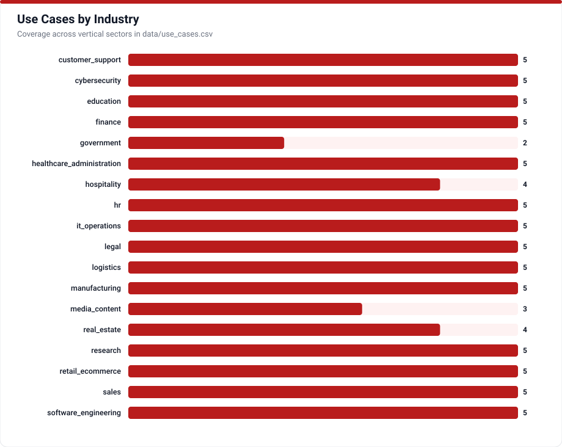

# Industry Use Cases & Operational Profiles

AI Agent Hub analyzes **83 concrete production and operational use cases** (`UC-001` through `UC-083`) across 15 industries including customer support, software engineering, cybersecurity, healthcare administration, legal, finance, retail, hospitality, and real estate. Every row states qualitative value without fabricated ROI percentages and links explicitly to real failure risks and required human oversight levels.

## Oversight & Deployment Discipline

- **High-Stakes Regulated Domains** (`healthcare_administration`, `legal`, `finance`, `hr`, `government`): Enforce mandatory approval gates (`PT-011`), immutable audit logging (`CP-073`), inline primary source citations (`CP-042`), and strict tenant corpus isolation (`RS-024`).
- **Automated Engineering & Operations** (`software_engineering`, `it_operations`, `cybersecurity`): Isolate dynamically executed tests or scripts inside ephemeral microVM sandboxes (`PT-021`) while correlating telemetry across observability platforms.

## Use Cases Catalog (`UC-001` to `UC-083`)

<!-- TABLE_USE_CASES:START -->
| ID | Industry | Use Case | Oversight | Maturity | Confidence |
|---|---|---|---|---|---|
| UC-001 | customer_support | Automated first-line support for FAQs and known issue patterns | review | established | high |
| UC-002 | customer_support | Ticket routing and classification | review | established | high |
| UC-003 | customer_support | Agent-assisted support with AI drafting and human review | approval | established | high |
| UC-004 | customer_support | Escalation detection and intelligent routing | review | growing | high |
| UC-005 | customer_support | Multilingual support automation | review | growing | high |
| UC-006 | sales | Lead qualification and scoring | review | established | high |
| UC-007 | sales | Outreach personalization at scale | approval | growing | high |
| UC-008 | sales | Sales call summary and next-step drafting | review | established | high |
| UC-009 | sales | Proposal generation with product configurator | approval | growing | medium |
| UC-010 | sales | CRM data enrichment | review | growing | high |
| UC-011 | hr | Job description writing and optimization | approval | established | high |
| UC-012 | hr | Resume screening and candidate ranking | approval | established | medium |
| UC-013 | hr | Interview question generation | review | established | high |
| UC-014 | hr | Onboarding document Q&A chatbot | review | established | high |
| UC-015 | hr | HR policy chatbot | review | established | high |
| UC-016 | legal | Contract review and clause extraction | approval | growing | high |
| UC-017 | legal | Legal research assistance | approval | growing | high |
| UC-018 | legal | Compliance monitoring and policy alerting | review | growing | medium |
| UC-019 | legal | NDA generation from templates | approval | established | high |
| UC-020 | legal | Regulatory change monitoring and impact assessment | review | growing | medium |
| UC-021 | healthcare_administration | Clinical documentation assistance | supervised | growing | high |
| UC-022 | healthcare_administration | Appointment scheduling optimization | review | established | high |
| UC-023 | healthcare_administration | Insurance pre-authorization assistance | approval | growing | high |
| UC-024 | healthcare_administration | Patient FAQ chatbot (non-diagnostic) | review | established | high |
| UC-025 | healthcare_administration | Medical coding assistance | approval | growing | high |
| UC-026 | finance | Financial report summarization | review | established | high |
| UC-027 | finance | Fraud alert triage | supervised | established | high |
| UC-028 | finance | Portfolio commentary generation | approval | growing | medium |
| UC-029 | finance | Expense report processing and policy checking | review | established | high |
| UC-030 | finance | Regulatory filing assistance | approval | growing | medium |
| UC-031 | retail_ecommerce | Product recommendation agent | review | established | high |
| UC-032 | retail_ecommerce | Inventory reorder agent | review | established | high |
| UC-033 | retail_ecommerce | Customer return processing | review | established | high |
| UC-034 | retail_ecommerce | Dynamic pricing analysis and recommendations | approval | growing | medium |
| UC-035 | retail_ecommerce | Product description generation | review | established | high |
| UC-036 | education | Personalized tutoring agent | supervised | growing | high |
| UC-037 | education | Assignment feedback assistant | review | growing | high |
| UC-038 | education | Course content Q&A | review | established | high |
| UC-039 | education | Plagiarism detection and constructive feedback | review | growing | medium |
| UC-040 | education | Administrative query handling for students | review | established | high |
| UC-041 | software_engineering | Code review assistance | review | established | high |
| UC-042 | software_engineering | Bug triage and reproduction agent | review | growing | high |
| UC-043 | software_engineering | Documentation generation from code | review | established | high |
| UC-044 | software_engineering | Test case generation | review | growing | high |
| UC-045 | software_engineering | Dependency vulnerability scanning | review | established | high |
| UC-046 | it_operations | Incident triage and routing | review | established | high |
| UC-047 | it_operations | Runbook automation | supervised | growing | high |
| UC-048 | it_operations | Log analysis and anomaly detection | review | established | high |
| UC-049 | it_operations | Infrastructure cost optimization recommendations | approval | growing | medium |
| UC-050 | it_operations | Change risk assessment | approval | growing | medium |
| UC-051 | cybersecurity | Security alert triage | supervised | established | high |
| UC-052 | cybersecurity | Threat intelligence summarization | review | established | high |
| UC-053 | cybersecurity | Phishing email detection | review | established | high |
| UC-054 | cybersecurity | Vulnerability explanation and prioritization | review | growing | high |
| UC-055 | cybersecurity | Incident response playbook execution | supervised | growing | high |
| UC-056 | logistics | Shipment status Q&A agent | review | established | high |
| UC-057 | logistics | Route optimization analysis | approval | established | medium |
| UC-058 | logistics | Supplier communication drafting | approval | established | medium |
| UC-059 | logistics | Customs documentation assistance | approval | growing | medium |
| UC-060 | logistics | Delivery exception handling | review | growing | high |
| UC-061 | manufacturing | Predictive maintenance alert analysis | review | established | high |
| UC-062 | manufacturing | Quality control defect reporting | review | established | high |
| UC-063 | manufacturing | Production schedule optimization analysis | approval | growing | medium |
| UC-064 | manufacturing | Supplier RFQ drafting | approval | established | medium |
| UC-065 | manufacturing | Safety incident documentation | approval | growing | medium |
| UC-066 | research | Literature review and summarization | review | established | high |
| UC-067 | research | Hypothesis generation assistance | review | growing | medium |
| UC-068 | research | Data analysis automation | supervised | growing | high |
| UC-069 | research | Research report drafting | review | established | high |
| UC-070 | research | Citation and bibliography management | review | established | medium |
| UC-071 | media_content | Content ideation and drafting | review | established | high |
| UC-072 | media_content | SEO analysis and optimization | review | established | high |
| UC-073 | media_content | Social media content scheduling and analysis | review | established | medium |
| UC-074 | government | Citizen service Q&A agent | review | growing | high |
| UC-075 | government | Policy document summarization | review | established | high |
| UC-076 | hospitality | Conversational hotel discovery and stay concierge | review | growing | high |
| UC-077 | hospitality | Natural-language travel itinerary planning and booking assistant | approval | growing | high |
| UC-078 | hospitality | Guest service inquiry and reservation exception resolution | review | growing | high |
| UC-079 | hospitality | Multilingual guest support and local recommendation agent | review | growing | high |
| UC-080 | real_estate | Automated lease abstraction and clause extraction | approval | growing | high |
| UC-081 | real_estate | Mortgage intake and loan document processing assistant | approval | growing | high |
| UC-082 | real_estate | Multilingual voice and chat property search and tenant lifecycle support | review | growing | high |
| UC-083 | real_estate | Property valuation and market intelligence synthesis | review | growing | medium |
<!-- TABLE_USE_CASES:END -->

Consult [`data/use_cases.csv`](../data/use_cases.csv) to inspect the mapped `agent_type_ids`, `pattern_ids`, `concept_ids`, `risk_ids`, and cited enterprise case studies for each entry.
